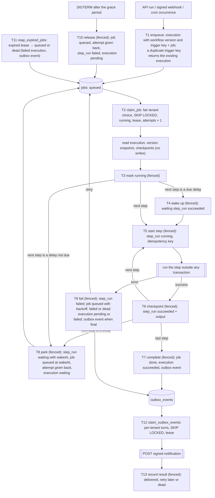

# FlowForge

Multi-tenant durable workflow platform. A workflow is a list of `http`, `transform`, `log` and `delay`
steps, started by the API, a signed webhook or cron. NestJS (API, worker, scheduler from one code base),
Next.js 15, PostgreSQL 16 as the only queue and state store.

[Running](#running) · [Architecture](#architecture) · [Guarantees](#execution-guarantees) ·
[Decisions](#design-decisions) · [Findings](#findings) · [Indexes](#indexes-and-query-plans) ·
[Tests, chaos, load](#tests-chaos-and-load) · [Changed tests](#changes-to-existing-tests) ·
[Not done](#not-done-or-done-differently)

## Running

```bash
cp .env.example .env                    # set ADMIN_TOKEN, CLIENT_ADDRESS_SECRET and the three passwords
cp apps/api/.env.example apps/api/.env
docker compose -p flowforge up -d --build --wait
scripts/smoke.sh                        # tenant → workflow → run → succeeded, frontend answers
```

UI http://localhost:3001, API http://localhost:3000, API reference [`docs/openapi.json`](docs/openapi.json)
(OpenAPI 3.1). Compose runs Postgres, a one-off `migrate`, the API, 2 workers, 2 schedulers, the
frontend and an nginx edge in front of it, published on `127.0.0.1` only; `/metrics` and `/health/{live,ready}` listen on 9100 inside the
compose network.

| File | Holds |
|---|---|
| `.env` | secrets (`openssl rand -hex 32` for `ADMIN_TOKEN`, `CLIENT_ADDRESS_SECRET`; `-hex 24` for `POSTGRES_PASSWORD`, `FLOWFORGE_OWNER_PASSWORD`, `FLOWFORGE_APP_PASSWORD`), ports, optional `APP_ORIGIN`, `TRUSTED_PROXY_HOPS` |
| `apps/api/.env` | every platform setting with its default, validated at start-up |
| `apps/frontend/.env` | `API_URL` for `npm run dev` |

- Only `migrate` gets the owner role; services connect as `flowforge_app` and refuse to start as the
  owner, a superuser or a `BYPASSRLS` role. Roles are created with the `flowforge_pgdata` volume.
- Behind TLS set `APP_ORIGIN=https://...`: `Origin` is checked against it, the key cookie is `Secure`,
  HSTS is sent. With proxies in front of the edge set `TRUSTED_PROXY_HOPS`.
- UI login: create a tenant (below) and paste its `apiKey` at `/connect`.

### Example requests

```bash
API=http://localhost:3000
ADMIN_TOKEN=$(grep ^ADMIN_TOKEN= .env | cut -d= -f2)
TENANT=$(curl -s -XPOST $API/tenants -H "x-admin-token: $ADMIN_TOKEN" -H 'content-type: application/json' -d '{"name":"demo"}')
KEY=$(echo "$TENANT" | jq -r .apiKey); SECRET=$(echo "$TENANT" | jq -r .webhookSecret)

WF=$(curl -s -XPOST $API/workflows -H "x-api-key: $KEY" -H 'content-type: application/json' -d '{
  "name": "order",
  "steps": [
    {"id": "order", "type": "http", "method": "POST", "url": "https://httpbin.org/anything/orders",
     "headers": {"content-type": "application/json"},
     "body": "{\"customer\": \"{{ input.customer }}\", \"amount\": {{ input.amount }}}"},
    {"id": "pause", "type": "delay", "ms": 3000},
    {"id": "summary", "type": "transform", "expr": "({ total: ctx.steps.order.body.json.amount * 1.2 })"}
  ]}' | jq -r .id)

EX=$(curl -s -XPOST $API/workflows/$WF/run -H "x-api-key: $KEY" -H 'x-request-id: demo-1' \
  -H 'content-type: application/json' -d '{"customer": "Ann", "amount": 100}' | jq -r .id)
curl -N $API/executions/$EX/events -H "x-api-key: $KEY"        # pending → running → waiting → succeeded
curl -s "$API/executions?status=succeeded&limit=20" -H "x-api-key: $KEY"   # next page: X-Next-Cursor

BODY='{"customer": "Bob", "amount": 50}'; ID=evt_1; TS=$(date +%s)
SIG=$(node -e 'const c=require("crypto");const [s,id,ts,b]=process.argv.slice(1);
console.log("v1,"+c.createHmac("sha256",Buffer.from(s.slice(6),"base64")).update(`${id}.${ts}.${b}`).digest("base64"))' \
  "$SECRET" "$ID" "$TS" "$BODY")
curl -s -XPOST $API/hooks/$WF -H 'content-type: application/json' \
  -H "webhook-id: $ID" -H "webhook-timestamp: $TS" -H "webhook-signature: $SIG" -d "$BODY"   # again: same executionId
```

Notifications: `PUT /notifications/endpoint {"url": "https://..."}` returns the signing secret once;
delivery state at `GET /notifications/events?status=dead`.

## Architecture

Processes `dist/main` (API), `dist/worker` (jobs, lease reaper, outbox, retention), `dist/scheduler`,
`dist/migrate` coordinate only through Postgres. Each `T` box is one transaction. Every worker write is
fenced: in the same transaction it checks that the job is still `running` with its `lockedBy` and `attempts`.



## Execution guarantees

| What | Guarantee | Conditions |
|---|---|---|
| Job | Run by at most one worker at a time | Lease + fencing; a worker gives a job up when its last renewal is older than the lease minus 1 s |
| `http` step | At least once; effectively once if the receiver deduplicates by `Idempotency-Key` | Key `<executionId>:<stepId>`, same body on every attempt; repeated only if the step did not finish |
| `transform`, `log` | At least once | No external effect |
| Succeeded step | Never run again | Output stored with the success in one fenced transaction |
| `delay` | Wakes no earlier than `wakeAt` | Survives restarts, holds no worker slot |
| Execution | One final state, steps of one version | Version fixed at creation; fails after `JOB_MAX_ATTEMPTS` (8) attempts of one step, a non-retryable error or outputs over `EXECUTION_OUTPUT_MAX_BYTES` |
| Webhook / cron trigger | One execution per `(workflow, webhook-id)` / `(workflow, scheduled time)` | Unique trigger key (+ row lock on the schedule) |
| API run | One execution per request | No client idempotency key |
| Notification | At least once, same `webhook-id` on every attempt | Written with the final status; 15 attempts with backoff, then `dead`; order not guaranteed |

## Design decisions

### 3.3.1 Queue
- **Chosen:** `claim_job` (`FOR UPDATE SKIP LOCKED`) sets a lease; heartbeats every third of the lease plus
  a local deadline (a missed renewal returns the job to the queue); a reaper in every worker; fencing on
  every write. Attempts count per step (`JOB_MAX_ATTEMPTS` 8), jittered exponential backoff
  (`RETRY_BASE_MS`, `RETRY_CAP_MS`); retryable: network errors, timeouts, 5xx, 408, 425, 429; exhausted
  jobs are `dead`. SIGTERM: stop claiming, wait `WORKER_SHUTDOWN_GRACE_MS`, release the rest without
  counting the attempt.
- **Why:** one statement claims, so a job cannot be taken twice; a lease runs a job for minutes without an
  open transaction; per-step attempts keep the progress of long workflows.
- **Alternatives:** advisory locks (no holder record, no "retry at"); `LISTEN/NOTIFY` only (not durable).
- **Limits:** a dead worker is noticed after lease + reaper pass (30 + 5 s); idle slots poll every 250 ms;
  the pool needs `2 × WORKER_CONCURRENCY + OUTBOX_CONCURRENCY + 2` connections.

### 3.3.2 Durable execution
- **Chosen:** one `step_runs` row per step; a retry rebuilds `ctx.steps` from succeeded rows and starts at
  the first unfinished step, so later steps read stored outputs and a retried request has the same bytes.
  `Idempotency-Key` and `X-Correlation-Id` on every http request. Changing `steps` inserts an immutable
  `workflow_versions` row; an execution runs the version it was created with.
- **Why:** checkpoint and success are one transaction, so a succeeded step is never computed again.
- **Alternatives:** copying steps into every execution (duplication, no history); event sourcing.
- **Limits:** effectively-once needs a receiver that honours the key.

### 3.3.3 Durable timers
- **Chosen:** `delay` marks its step `waiting` with `wakeAt` and requeues the job with `runAt = wakeAt`,
  giving the attempt back, in one transaction.
- **Why:** the timer is a row: survives restarts, needs no extra process, holds no slot.
- **Alternatives:** a timers table with its own poller.
- **Limits:** wake-up is late by up to the poll interval, or while the tenant is at its concurrency limit.

### 3.3.4 Tenant isolation and limits
- **Chosen:** services connect as `flowforge_app` (`NOBYPASSRLS`); the schema belongs to `flowforge_owner`.
  Every tenant table has row level security on `app.tenant_id`, set per transaction by `TenantDb.run`;
  services also filter by `tenantId`; foreign keys `(tenantId, executionId)` stop a row of one tenant from
  pointing at another tenant's execution. Cross-tenant work (key lookup, webhook routing, claims, reaper,
  retention, metrics) goes through narrow `SECURITY DEFINER` functions. Row level security is not
  `FORCE`d on purpose: only the owner bypasses it, and the owner is used by migrations and those
  functions; tables without policies (`tenant_queue_state`, `rate_limit_windows`, `execution_watches`)
  are not granted to `flowforge_app` at all.
- **Limits per tenant** (`PATCH /tenants/:id/limits`): running jobs (exact, in `claim_job`), queued jobs
  (`429` + `Retry-After`), requests per minute (window in Postgres, `X-RateLimit-*`), workflows
  (`TENANT_MAX_WORKFLOWS`). Failed authentication is limited per client address in memory before any
  database work (`AUTH_FAILURES_PER_MINUTE`), separately for API keys, the admin token and each
  workflow's webhooks (counted only after a wrong signature). The frontend passes the browser's address
  with `CLIENT_ADDRESS_SECRET`, so one visitor cannot lock all users out of the UI. The address is the
  one the nginx edge appends to `X-Forwarded-For`: Next.js keeps a header the client sent, so without
  the edge any visitor could pick the address it is counted under.
- **Why:** a missing check in code still cannot leak data; a query without tenant context sees nothing
  (`tenancy/row-level-security.int-spec.ts`).
- **Alternatives:** schema per tenant (migrations × tenants); in-memory rate limits (grow with instances).
- **Limits:** the queue limit is soft under concurrent requests; the rate window allows up to 2× at its edge.

### 3.3.5 Fair scheduling
- **Chosen:** `tenant_queue_state` holds per tenant the last claim and `idleUntil`, the time before which
  it has no ready job. `claim_job` takes non-idle tenants, least recently served first, locks one whose
  concurrency limit allows it and claims its oldest ready job; a tenant with nothing ready is marked idle
  until its earliest job. A trigger on `jobs` wakes the tenant when a job is queued; the enqueue holds
  `FOR KEY SHARE` on the tenant row and the idle mark needs `FOR UPDATE` plus a second look at the jobs,
  so a job committed meanwhile is never missed.
- **Why:** round-robin: a backlog costs other tenants at most one job per turn ([measured](#load-fair-scheduling));
  tenants with only later jobs cost nothing (5 000 of them: 1.2–1.6 ms per claim instead of 18–21 ms).
- **Alternatives:** a queue and dispatcher per tenant; random tenant choice (weaker tail); a skip scan over
  all tenants with queued jobs (the previous version, linear in tenants).
- **Limits:** fair per job, not per CPU time; no weights.

### 3.3.6 Safe step execution
- **`http`:** guarded undici agent. The URL template needs a fixed origin; values are percent-encoded; the
  rendered origin is re-checked; `.`/`..` segments and backslashes are refused. Its `lookup` resolves every
  address (2 s) and refuses any that is not public unicast, then connects to the checked address, so DNS
  rebinding cannot redirect it. Redirects are followed by hand (`HTTP_MAX_REDIRECTS`), each hop checked,
  credentials and custom headers dropped across origins. One deadline per step (`HTTP_TIMEOUT_MS`), body
  cut at `HTTP_MAX_RESPONSE_BYTES`; JSON bodies are rendered with JSON escaping.
- **`transform`:** JavaScript in QuickJS (WebAssembly) in a small thread pool; each evaluation gets a fresh
  runtime with `TRANSFORM_MEMORY_MB`, a 48 KiB stack and `TRANSFORM_TIMEOUT_MS`; JSON in and out, so no
  host object is reachable; a returned promise is an error; the result size is checked inside the
  sandbox; a thread that misses the deadline is replaced.
- **All steps:** outputs over `STEP_OUTPUT_MAX_BYTES` or 64 levels, or over `EXECUTION_OUTPUT_MAX_BYTES`
  per execution, fail without retry; rendered urls (8 KiB) and bodies (1 MiB) are bounded while they
  render; definitions are limited (50 steps, body 64 KiB, expression 4 KiB, delay ≤ 1 h).
- **Why QuickJS:** workflows already use JavaScript expressions; `vm`/`new Function` are not a boundary;
  `isolated-vm` is a native module per Node version; WebAssembly has no Node APIs and exact limits.
- **Alternatives:** `request-filtering-agent` (no redirect control), an egress proxy, an expression language.
- **Limits:** the SSRF guard lives in the worker; `SSRF_ALLOWLIST` bypasses it per host; built-ins like
  `'x'.repeat(n)` ignore the deadline, so the hard kill comes at twice the timeout.

### 3.3.7 Incoming webhooks
- **Chosen:** Standard Webhooks: `v1,<base64 HMAC-SHA256(id.timestamp.raw body)>` over the bytes as
  received (compressed bodies `415`), `timingSafeEqual` against every active secret, timestamp within
  `WEBHOOK_TOLERANCE_SECONDS`, trigger key `webhook:<workflowId>:<webhook-id>` with a unique index.
  Rotation: `POST /webhook-secrets` returns a new secret once; old ones stay valid for
  `WEBHOOK_SECRET_GRACE_SECONDS`; at most three are active.
- **Why:** senders already implement the scheme; the unique key makes any later redelivery a no-op.
- **Alternatives:** a seen-ids table cleaned after the window (lets late retries through); canonical JSON.
- **Limits:** secrets are stored in plain text, protected by row level security.

### 3.3.8 Scheduler
- **Chosen:** a separate process (two replicas); a tick claims one due workflow at a time by indexed
  `nextRunAt` (`FOR UPDATE SKIP LOCKED`), enqueues with trigger key `cron:<workflowId>:<time>` and moves
  `nextRunAt` in the same transaction. Runs missed beyond `SCHEDULER_MISFIRE_GRACE_MS`: `skip`, `once`
  (default) or `all` (up to `SCHEDULER_MAX_CATCH_UP_RUNS`); skipped runs are counted and logged. A full
  tenant queue postpones by `SCHEDULER_POSTPONE_MS` without blocking other tenants.
- **Time zones:** `cron-parser` lists wall-clock times and `src/scheduler/zoned-cron.ts` maps them to the
  zone with `Intl` offsets: with fixed hours a missing time moves forward and a repeated one runs once;
  with every hour (`*`, `*/n`, `0-23`) the schedule follows elapsed time. Tested over two years in 17
  zone and time cases in 11 zones, including 30-minute, 2-hour and midnight changes.
- **Why:** the row lock and the unique key each prevent a second run on their own.
- **Alternatives:** leader election with an advisory lock (one busy instance, failover waits for the session).
- **Limits:** the start moment depends on the scheduler host clock; crons more often than once a minute
  are refused; `enabled: false` stops cron and webhooks, a manual run still works.

### 3.3.9–3.3.11 Notifications, observability, frontend
- **Outbox:** a row in the transaction of every final status; the dispatcher claims with `SKIP LOCKED`,
  per-tenant turns, at most `OUTBOX_TENANT_CONCURRENCY` in flight, posts through the SSRF guard, signs like
  a webhook with separate secrets, retries with backoff.
- **Observability:** `x-request-id` becomes `executions.correlationId` (cron runs get a new one), is logged
  with tenant, execution, job, attempt and step and sent as `X-Correlation-Id`; pino JSON logs with secrets
  redacted; metrics `flowforge_queue_depth{tenant_id,status}`, `flowforge_job_claim_latency_seconds`,
  `flowforge_step_duration_seconds`, `flowforge_job_retries_total`, `flowforge_jobs_dead_total` and more.
  Queue depth and outbox backlog are read from the database by the API only, so worker and scheduler
  replicas do not repeat that query; the counters come from the process that does the work.
- **Real time:** SSE, because updates flow one way and SSE reconnects by itself and passes through the
  Next.js proxy as plain HTTP; fed by `pg_notify` triggers for executions a stream watches. Snapshots
  leave out outputs over 8 KiB (`/executions/{id}/output`), streams of one execution share one read, a
  slow client gets only the latest snapshot.
- **Frontend:** the page closes its stream on unmount and on a final status, reconnects with backoff and
  shows the last snapshot if the stream is refused; executions list with cursor pages and a status filter;
  workflow form with the API rules and `If-Match` on the workflow's `revision`, which grows with any edit
  (`412` on a stale form; `version` counts step versions only); loading, empty and error
  states; CSP with a nonce per response; proxy answers streamed, `no-store`, up to 32 MiB.
- **Retention:** workers delete data finished more than `RETENTION_DAYS` (30) ago and unused versions.

## Findings

Each finding has a reproduction that fails on the commit adding it and passes on the next one (the fix);
`scripts/prove-finding.sh F-NN` checks both. Lines refer to `initial commit` (`5acc271`); paths are under
`apps/api` unless they start with `apps/`. F-21 (non-atomic transitions) is part of F-18.

### F-01 · Any tenant can read any execution by id · Tenant isolation · Critical
- **What:** `src/executions/executions.controller.ts:31-34`, `src/executions/executions.service.ts:33-37` look up by id only.
- **Why dangerous:** any API key reads another tenant's input, output and step results.
- **Reproduce:** `test/integration/findings/F-01-execution-detail-isolation.int-spec.ts`.
- **Fix** (`c77c536`): lookup by `(id, tenantId)`, row level security on top.
- **Alternatives:** checking the owner in each controller (easy to forget).

### F-02 · Tenant isolation unit test cannot fail · Tests that pass regardless · Medium
- **What:** `test/executions.service.spec.ts:8,23-26` mocks the repository to return `[]` and expects `[]`.
- **Why dangerous:** green for any implementation, including one returning every tenant's data.
- **Reproduce:** `scripts/prove-finding.sh F-02` runs `scripts/mutation/F-02.sh` (removes the tenant filter of the starter query) at both commits: the old test stays green, the new one fails.
- **Fix** (`0bc710c`): `test/integration/findings/F-02-execution-list-isolation.int-spec.ts`, two tenants on a real database.
- **Alternatives:** asserting mock arguments (still tied to the implementation).

### F-03 · Concurrent workers execute the same job several times · Queue, several workers · Critical
- **What:** `src/engine/job-queue.service.ts:17-34`: `SELECT`, then `UPDATE` by id without a lock or status check.
- **Why dangerous:** slots polling at the same moment take the same job; payments or emails repeat.
- **Reproduce:** `test/integration/findings/F-03-exactly-once-claim.int-spec.ts` (4 workers × 4 slots, 60 jobs).
- **Fix** (`7f29ccb`): one `UPDATE ... FOR UPDATE SKIP LOCKED` in `claim_job`.
- **Alternatives:** advisory locks; optimistic `WHERE status = 'queued'` with retries.

### F-04 · Jobs of a crashed worker are never recovered · Worker crash · Critical
- **What:** `src/engine/job-queue.service.ts:6,17-21` ignores `lockedUntil`; `src/engine/job-runner.service.ts:36-50` never renews the lease.
- **Why dangerous:** a killed worker leaves its jobs `running` forever.
- **Reproduce:** `test/integration/findings/F-04-lease-recovery.int-spec.ts`.
- **Fix** (`99f8e63`): heartbeat, reaper (`queued`, or `dead` with a failed execution), fencing.
- **Alternatives:** a transaction or advisory lock held per job (cannot span a delay).

### F-05 · A stopping worker abandons its current job · Worker crash · High
- **What:** `src/engine/job-runner.service.ts:32-34` only sets `running = false`.
- **Why dangerous:** every deploy strands in-flight jobs.
- **Reproduce:** `test/integration/findings/F-05-graceful-shutdown.int-spec.ts` (SIGTERM to a real worker process mid-step).
- **Fix** (`25432ff`): stop claiming, wait up to 25 s (compose `stop_grace_period` 30 s), release the rest.
- **Alternatives:** only waiting or only releasing.

### F-06 · A job whose workflow was deleted hangs forever · Poison jobs · High
- **What:** `src/engine/job-runner.service.ts:53-54` loads with `findOneOrFail` outside the `try`; `src/workflows/workflows.service.ts:55-58` deletes workflows with queued runs.
- **Why dangerous:** the job stays `running` and the execution `pending` forever.
- **Reproduce:** `test/integration/findings/F-06-poison-job.int-spec.ts`.
- **Fix** (`3d91407`): a missing execution, workflow or version fails the job with a reason.
- **Alternatives:** forbidding deletion while runs are queued.

### F-07 · Transform steps run arbitrary code on the host · Step security · Critical
- **What:** `src/engine/step-executor.ts:30-37` uses `new Function`.
- **Why dangerous:** `process.env` (database credentials, admin token), `child_process`; `while(true){}` blocks the worker.
- **Reproduce:** `test/integration/findings/F-07-transform-sandbox.int-spec.ts`.
- **Fix** (`55505f6`): QuickJS sandbox ([3.3.6](#336-safe-step-execution)).
- **Alternatives:** `vm`, `isolated-vm`, an expression language.

### F-08 · Http steps can reach internal addresses · Step security · Critical
- **What:** `src/engine/step-executor.ts:39-46` fetches any URL and follows redirects.
- **Why dangerous:** cloud metadata, Postgres and the API in the compose network, loopback services.
- **Reproduce:** `test/integration/findings/F-08-ssrf.int-spec.ts` (six loopback notations, a redirect from an allowed host); private ranges, metadata, IPv6 and DNS rebinding in `test/safe-http.spec.ts` (added with the fix).
- **Fix** (`59434fe`): guarded undici agent ([3.3.6](#336-safe-step-execution)).
- **Alternatives:** filtering agents for `http.Agent`, an egress proxy.

### F-09 · Step results are read and stored without a size limit · Resource limits · High
- **What:** `src/engine/step-executor.ts:47` (`res.text()`), `:18` (log), `src/engine/job-runner.service.ts:68` (output).
- **Why dangerous:** one huge response exhausts the worker's memory; huge outputs bloat the database.
- **Reproduce:** `test/integration/findings/F-09-response-size-limits.int-spec.ts`.
- **Fix** (`0c154e4`): `content-length` check, streaming cap, output cap, log cap; non-retryable.
- **Alternatives:** silent truncation.

### F-10 · Input values can rewrite the url of an http step · Step security · High
- **What:** `src/engine/template.ts:16-21` inserts values as they are; `src/engine/step-executor.ts:40` renders the URL.
- **Why dangerous:** `https://api.example.com{{ input.p }}` with `p="@169.254.169.254/"` changes the host.
- **Reproduce:** `test/integration/findings/F-10-url-template-injection.int-spec.ts`.
- **Fix** (`ee31917`): percent-encoding, fixed origin required and re-checked, own properties only.
- **Alternatives:** no placeholders in URLs; checking only the host.

### F-11 · Webhook signatures are checked against a re-serialized body · Webhook authenticity · High
- **What:** `src/webhooks/webhooks.controller.ts:31` signs `JSON.stringify(parsed body)`.
- **Why dangerous:** signatures over the real bytes fail; different bodies share a signature; non-JSON is verified as `{}`.
- **Reproduce:** `test/integration/findings/F-11-raw-body-signature.int-spec.ts`.
- **Fix** (`b791793`): HMAC over the raw bytes; `415` for non-JSON.
- **Alternatives:** canonical JSON.

### F-12 · Webhook signatures are compared with a timing leak · Webhook authenticity · Medium
- **What:** `src/webhooks/webhooks.controller.ts:32` uses `!==`.
- **Why dangerous:** response time reveals how much of a guessed signature is right.
- **Reproduce:** `test/integration/findings/F-12-constant-time-signature.int-spec.ts`.
- **Fix** (`3cf2c69`): base64 decode, fixed 32-byte length, `timingSafeEqual`.
- **Alternatives:** comparing HMACs of both values.

### F-13 · Replayed and stale webhooks start new executions · Webhook redelivery · High
- **What:** `src/webhooks/webhooks.controller.ts:20-38`: no timestamp, window or deduplication.
- **Why dangerous:** a captured request can be replayed any time; a sender's retry runs the workflow twice.
- **Reproduce:** `test/integration/findings/F-13-webhook-replay.int-spec.ts` (replay, retry with a fresh timestamp, 10 concurrent duplicates).
- **Fix** (`f9ee8af`): id and timestamp in the signature, tolerance window, unique trigger key.
- **Alternatives:** a seen-ids table with expiry.

### F-14 · Every scheduler instance fires the same occurrence · Scheduler, several instances · High
- **What:** `src/scheduler/scheduler.service.ts:19-22,29-46` runs in every API instance (`src/app.module.ts:29`) without coordination.
- **Why dangerous:** N replicas run each cron workflow N times.
- **Reproduce:** `test/integration/findings/F-14-scheduler-multi-instance.int-spec.ts`.
- **Fix** (`cc545b7`): scheduler process, row-locked claim, unique trigger keys.
- **Alternatives:** leader election; the unique key alone.

### F-15 · Schedules ignore their time zone · Scheduler, time zones · High
- **What:** `src/scheduler/scheduler.service.ts:38` calls `parseExpression` without `tz`.
- **Why dangerous:** runs in the process time zone (UTC in Docker), ignoring the tenant's DST.
- **Reproduce:** `test/integration/findings/F-15-schedule-time-zones.int-spec.ts` (winter, summer, spring gap, autumn repeat).
- **Fix** (`206afc7`): the workflow's time zone; zones validated.
- **Alternatives:** another cron library.

### F-16 · Runs missed while the scheduler is down are lost · Scheduler, restart · High
- **What:** `src/scheduler/scheduler.service.ts:12` keeps `lastTick` in memory; `:43-47` moves it on after an enqueue error.
- **Why dangerous:** downtime or a failed enqueue silently drops runs.
- **Reproduce:** `test/integration/findings/F-16-missed-runs-after-restart.int-spec.ts`.
- **Fix** (`91a7b34`): persistent `nextRunAt`, moved only with the enqueue; missed-run policies.
- **Alternatives:** persisting `lastTick` per instance.

### F-17 · A slow scheduler tick overlaps the next and fires twice · Scheduler, restart · Medium
- **What:** `src/scheduler/scheduler.service.ts:21` uses `setInterval` with an async tick.
- **Why dangerous:** a tick slower than the interval overlaps the next with the same `lastTick`.
- **Reproduce:** `test/integration/findings/F-17-overlapping-ticks.int-spec.ts`.
- **Fix** (`ab5eea8`): ticks chained with `setTimeout`.
- **Alternatives:** a "running" flag.

### F-18 · A retry repeats steps that already succeeded · Execution properties · Critical
- **What:** `src/engine/job-runner.service.ts:60-64` starts from step 0 on every attempt; `:56-91` updates three tables in separate statements.
- **Why dangerous:** a failure in a later step repeats earlier side effects; a crash between statements leaves e.g. a `succeeded` execution with a `running` job.
- **Reproduce:** `test/integration/findings/F-18-resume-from-checkpoint.int-spec.ts`; non-atomic transitions by mutation: `scripts/mutation/starter-defects.sh non-atomic-completion` makes `test/integration/outbox/notifications.int-spec.ts` fail.
- **Fix** (`b02e231`): fenced per-step checkpoints, one transaction per transition, idempotency keys.
- **Alternatives:** event sourcing; requiring idempotent steps from users.

### F-19 · A running execution picks up edits of its workflow · Execution properties · High
- **What:** `src/engine/job-runner.service.ts:54` loads the current workflow; `src/workflows/workflows.service.ts:45-48` keeps no history.
- **Why dangerous:** one execution mixes steps of two versions.
- **Reproduce:** `test/integration/findings/F-19-workflow-version-snapshot.int-spec.ts`.
- **Fix** (`4847db6`): immutable `workflow_versions`.
- **Alternatives:** copying steps into executions.

### F-20 · A delay holds a worker slot and restarts after a crash · Execution properties · High
- **What:** `src/engine/step-executor.ts:20-22` uses `setTimeout`.
- **Why dangerous:** a 1 h delay blocks a slot for an hour; a restart starts the execution over.
- **Reproduce:** `test/integration/findings/F-20-durable-delay.int-spec.ts`.
- **Fix** (`a762382`): durable timers ([3.3.3](#333-durable-timers)).
- **Alternatives:** a separate timers table.

### F-22 · The execution page polls forever and leaks its timer · Client that degrades · Medium
- **What:** `apps/frontend/app/executions/[id]/page.tsx:11-16`: `setInterval` without cleanup.
- **Why dangerous:** every visit adds a timer that never stops; requests overlap; errors show "Loading…" forever.
- **Reproduce:** `apps/frontend/test/findings/F-22-execution-page-updates.test.tsx`.
- **Fix** (`09fc220`): SSE with cleanup, stop on a final status, error and reconnect states.
- **Alternatives:** fixing the polling.

### F-23 · Input is not validated at the API boundary · Validation · Medium
- **What:** `src/workflows/workflows.service.ts:7-13,29` takes an interface; `src/executions/executions.controller.ts:27-28` uses `Number(limit)`.
- **Why dangerous:** a missing `name` or `limit=abc` answers `500`; invalid cron or zone is stored; `* * * * * *` runs every second.
- **Reproduce:** `test/integration/findings/F-23-input-validation.int-spec.ts`.
- **Fix** (`b503556`): DTO classes, query DTO, cron and zone checks, definition limits.
- **Alternatives:** one JSON schema for the definition.

### F-24 · Webhook responses reveal which workflows exist · Webhook authenticity · Low
- **What:** `src/webhooks/webhooks.controller.ts:27-28`: `404` for unknown or disabled workflows, `401` for a bad signature.
- **Why dangerous:** workflow ids can be probed without a secret.
- **Reproduce:** `test/integration/findings/F-24-webhook-enumeration.int-spec.ts`.
- **Fix** (`a8280f7`): the same `401` in all three cases.
- **Alternatives:** equalising response time as well.

### F-25 · API runs as a database superuser and accepts a placeholder admin token · Security, configuration · High
- **What:** `docker-compose.yml:4-7`, `.env.example:2` connect as the superuser; `src/app.module.ts:22` has `synchronize: true`; `.env.example:3` is a placeholder `ADMIN_TOKEN`.
- **Why dangerous:** any injection owns the database, row level security is impossible, the schema changes on start, anyone can create tenants.
- **Reproduce:** `test/integration/findings/F-25-least-privilege.int-spec.ts`.
- **Fix** (`02fd4b4`): owner and app roles, migrations, refusing a placeholder token in production.
- **Alternatives:** one non-superuser role for everything.

### F-26 · A NUL character makes data impossible to store · Validation, storage · Medium
- **What:** Postgres cannot store `\u0000`; request bodies (`src/main.ts:6`) and step results (`src/engine/job-runner.service.ts:68,70`) are not checked.
- **Why dangerous:** `500` with a database error; a response with NUL fails every attempt.
- **Reproduce:** `test/integration/findings/F-26-nul-characters.int-spec.ts`.
- **Fix** (`2c7af7b`): `400` for such bodies, U+FFFD in stored results (later also lone UTF-16 surrogates).
- **Alternatives:** storing outputs as `bytea`.

### F-27 · Deeply nested JSON crashes the API and poisons steps · Resource limits · Medium
- **What:** `src/main.ts:6` and `src/engine/job-runner.service.ts:68` accept any nesting.
- **Why dangerous:** stack overflow answers `500`; such a step response fails every attempt.
- **Reproduce:** `test/integration/findings/F-27-deeply-nested-json.int-spec.ts`.
- **Fix** (`e23b2a1`): iterative depth check (64) of bodies (`400`) and outputs (non-retryable).
- **Alternatives:** catching `RangeError`.

### F-28 · One tenant's backlog delays every other tenant · Fairness · High
- **What:** `src/engine/job-queue.service.ts:19` claims in global `runAt` order.
- **Why dangerous:** other tenants wait for the whole backlog (p95 31 s in the load test).
- **Reproduce:** `test/integration/findings/F-28-noisy-neighbour.int-spec.ts`, `npm run load:fairness`.
- **Fix** (`e33c796`): round-robin claim ([3.3.5](#335-fair-scheduling)).
- **Alternatives:** per-tenant queues; random tenant choice.

### F-29 · Input values can inject fields into an http step body · Step security · High
- **What:** `src/engine/step-executor.ts:44` renders the body without encoding.
- **Why dangerous:** `{"name": "{{ input.name }}"}` with `x", "role": "admin` adds a field; `x&role=admin` does it in a form.
- **Reproduce:** `test/integration/findings/F-29-body-template-injection.int-spec.ts`.
- **Fix** (`e2a9f3f`): values encoded for the body format (JSON string, JSON value, form).
- **Alternatives:** a structured body object; no placeholders in bodies.

### Starter defects fixed without a red commit

Fixed while building a feature, so they are proven by mutation: `scripts/mutation/starter-defects.sh [mutant]`
copies the app, checks the test passes, puts the starter defect back and requires the test to fail (6/6 killed).

| Defect (starter) | Why dangerous | Fix | Test · mutant | Alternative |
|---|---|---|---|---|
| No database timeouts (`src/app.module.ts:18-23`) · Resources · High | a paused Postgres makes every request and worker hang | `987ffa7`: connect, statement, client timeouts | `db/timeouts.int-spec.ts` · `database-timeouts` | per-query timeouts |
| Admin token checked after body validation (`src/tenants/tenants.controller.ts:27-31`) · Security · Low | anyone learns the admin API from `400` answers | `987ffa7`: guard before validation | `tenancy/admin-endpoint.int-spec.ts` · `admin-token-after-validation` | a separate admin port |
| Frontend proxy without a deadline (`apps/frontend/app/api/proxy/[...path]/route.ts`) · Resources · Medium | a hanging API holds frontend requests forever | `24bcf46`: `AbortSignal.timeout`, `504` | `apps/frontend/test/proxy-route.test.ts` · `proxy-without-timeout` | reverse-proxy timeout |
| Frontend proxy forwards any path segment (same file) · Security · Medium | `..` or encoded segments reach API routes the UI never calls | `24bcf46`: segments `[A-Za-z0-9_-]+` | `proxy-route.test.ts` · `proxy-without-path-check` | route allowlist |
| `/api/connect` without origin check · Security · Medium | login CSRF: the user acts in the attacker's tenant | `24bcf46`: `Origin` must match | `connect-route.test.ts` · `connect-without-origin-check` | CSRF token |
| Non-atomic transitions (F-21, part of F-18) | a crash leaves a `done` job with a `running` execution | `b02e231`: one fenced transaction per transition | `outbox/notifications.int-spec.ts` · `non-atomic-completion` | — |

Defects in the new code, found by four code reviews, are fixed in the commits `fix: resolve defects found
in the final / second / third / fourth code review`, each with tests that failed before it. Fencing of
every worker write is proven by `scripts/mutation/fencing.sh` (2/2 killed).

One more starter defect came up in the last review: `createdAt` of tenants, workflows, executions, jobs and
`startedAt` of steps were `timestamp` without a time zone (`@CreateDateColumn()`, e.g.
`src/entities/execution.entity.ts:32`). With a database time zone other than UTC, the API reported these
times shifted by the offset, so durations in the UI were wrong by hours. They are `timestamptz` now and
cursors are read in UTC; `db/database-time-zone.int-spec.ts` failed before the fix (12 h off). The same review found
that the `ETag` of a workflow was its step version, so two concurrent edits of the name or schedule
overwrote each other; it is a `revision` column now (`api/workflow-concurrent-edits.int-spec.ts`). API
responses now carry `Cache-Control: no-store` and `X-Content-Type-Options: nosniff` and no `X-Powered-By`
(`api/response-headers.int-spec.ts`). The frontend was published directly, and Next.js keeps an
`X-Forwarded-For` sent by the client, so a visitor could send a new address with every login attempt and
never be limited, or lock out someone else's address; the nginx edge now appends the real address
(`scripts/smoke.sh`, run by CI, requires a forged header to be limited like any other).

## Indexes and query plans

| Query | Index |
|---|---|
| Tenants that may have ready jobs | `IDX_tenant_queue_state_idle (idleUntil)` |
| Oldest ready job of a tenant, queue limit | `IDX_jobs_queued_by_tenant (tenantId, runAt) WHERE status='queued'` |
| Running jobs of a tenant, expired leases | `IDX_jobs_running_by_tenant`, `IDX_jobs_expired_leases (lockedUntil)` (partial on `running`) |
| Executions of a tenant: newest first, by status, by workflow | `IDX_executions_tenant_created`, `_tenant_status_created`, `_tenant_workflow_created` (end with `createdAt, id`) |
| Workflows of a tenant | `IDX_workflows_tenant_created (tenantId, createdAt, id)` |
| Idempotency of webhooks and cron | `UQ_executions_tenant_trigger_key (tenantId, triggerKey) WHERE NOT NULL` |
| Checkpoints, version snapshot | `UQ_step_runs_execution_step`, `UQ_workflow_versions_workflow_version` |
| Next due schedule | `IDX_workflows_due (COALESCE(scheduleRetryAt, nextRunAt))` (partial) |
| Notifications: due, abandoned, of a tenant | `IDX_outbox_events_pending_by_tenant`, `_expired_leases`, `_tenant_created`, `_tenant_status_created` |
| Retention | `IDX_executions_finished`, `IDX_executions_unfinished_version`, `IDX_outbox_events_finished`, `IDX_outbox_events_execution`, `IDX_jobs_execution`, `IDX_execution_watches_expires` |
| Same-tenant references | `UQ_executions_tenant_id (tenantId, id)` for the foreign keys of steps, jobs, notifications |

**How verified:** `test/integration/db/query-plans.int-spec.ts` loads 50 tenants, 5 000 workflows,
100 000 executions and jobs, 160 000 step runs, 50 000 notifications and a tenant with 10 000 sleeping
jobs, calls the real services as the application role and reads every plan through `auto_explain`, also
inside PL/pgSQL functions. It requires the expected index, no sequential scan of a large table, no sort
of more than a page and, for claims, fewer than 1 000 rows discarded by a filter; dropping an index fails
it. `QUERY_PLAN_REPORT=plans.md npx jest query-plans` writes the measured times.

## Tests, chaos and load

```bash
cd apps/api && npm ci && npm run lint && npm run typecheck
npm run test:unit                # no database
npm run test:int                 # Postgres 16 via Testcontainers (Docker)
cd ../frontend && npm ci && npm run lint && npm run typecheck && npm test && npm run build
cd ../.. && scripts/prove-finding.sh F-03          # red before the fix, green after it
scripts/mutation/starter-defects.sh && scripts/mutation/fencing.sh
```

Each integration test file gets its own database cloned from a migrated template; `TEST_DATABASE_URL`
(superuser) uses an existing server instead (needs `psql`). CI runs lint, typecheck, all tests, a
production dependency audit, builds the images, starts the stack and runs `scripts/smoke.sh`.

| Requirement (task 6) | Tests |
|---|---|
| Backoff, definition validation, sandbox, webhook signature, cron in time zones and on DST dates | `test/retry-backoff.spec.ts`, `definition.spec.ts`, `sandbox.spec.ts`, `webhook-signature.spec.ts`, `cron-schedule.spec.ts` |
| N workers × M jobs, each exactly once | F-03 |
| Worker killed mid-step: picked up, finished steps not repeated, side effect once | `integration/chaos/worker-killed-mid-step.int-spec.ts`, F-04, F-18 |
| Two scheduler instances, one run | F-14, `scheduler/scheduling.int-spec.ts` |
| Tenant A cannot see or change B, also bypassing services | `tenancy/row-level-security.int-spec.ts`, `tenancy/api-isolation.int-spec.ts`, `tenancy/cross-tenant-references.int-spec.ts`, F-01, F-02 |
| SSRF (loopback, private, cloud metadata, redirect), sandbox escape, webhook replay, changed body | `safe-http.spec.ts`, F-08, F-07, F-13, F-11 |
| Every starter finding | `test/**/findings/F-NN-*`, `scripts/mutation/*` |
| OpenAPI matches the API | `api/openapi.int-spec.ts` |

### Chaos: all workers killed in the middle of a payment

```bash
docker compose -p flowforge -f docker-compose.yml -f docker-compose.chaos.yml up -d --build
cd apps/api && npm run chaos:kill-workers
```

The overlay adds `sink` (`docker/chaos/sink.js`): it applies each effect once per `Idempotency-Key`,
holds the first `/charge` for 6 s and records notifications. The script runs 10 executions of
`reserve → charge → delay 2 s → email`, SIGKILLs both workers while charges are in flight, restarts them
and fails if any guarantee is broken. Three runs, Apple M1, Docker 8 CPUs:

| Finished after the kill | Succeeded | reserve: attempts / requests / effects | charge | email | Notifications |
|---|---|---|---|---|---|
| 32.6–37.6 s | 10 / 10 | 10×1 / 10 / 10 | 2×1 + 8×2 / 18 / 10 | 10×1 / 10 / 10 | 10, distinct ids |

Killed jobs return after the 30 s lease and a reaper pass; interrupted charges ran again with the same
key and were applied once; reserve was not repeated. With a key per attempt, or without checkpoints, the
script fails.

### Load: fair scheduling

```bash
cd apps/api && npm run load:fairness
```

Tenant A enqueues 20 000 executions while workers are stopped; then workers start and tenants B and C
start one execution per second for 60 s. Latency: creation to start of the first step. 2 workers × 4
slots, Apple M1, Docker 8 CPUs. Baseline: the code before the fix (`e1c84fc`).

| Claim order | B and C while A's backlog drains: p50 / p95 / p99, ms | After it drained: p95, ms | Backlog drain |
|---|---|---|---|
| FIFO (baseline) | 16 161 / 31 139 / 32 115 | 238–243 | 622 jobs/s |
| Round-robin (current) | 14–15 / 31–34 / 825–861 | 254–269 | 452 jobs/s |

The baseline also lacks everything added later (live-update triggers, outbox, logging context, metrics,
limits), so the throughput difference is not the cost of the fair claim alone.

## Changes to existing tests

| File | Change | Reason |
|---|---|---|
| `apps/api/test/executions.service.spec.ts` (starter) | removed | could not fail (F-02), replaced by a real test |
| `apps/api/test/job-queue.spec.ts` (starter) | removed two `it.todo` | implemented by F-03 and F-04 |
| `findings/F-09-*` | 256 KiB output with a 64 KiB limit instead of 8 MB; receiver removes its listeners | 8 MB hit the transform timeout under load; listeners piled up |
| `findings/F-12-*` | tampers with the signature header only | headers added by F-13 hid what F-12 checks |
| `tenancy/tenant-limits.int-spec.ts` | no `429` expected among concurrent requests | the queue limit is soft by design |
| `findings/F-20-*`, `execution/checkpoints`, `queue/lease*`, `chaos/worker-killed-mid-step` | wait for a state, not a fixed time; `DB_STATEMENT_TIMEOUT_MS=1500` | fixed sleeps were flaky; the lease must exceed the statement timeout |
| `apps/frontend/test/findings/F-22-*` | assertions on connections, requests and timers after failures and the final status | the old ones passed whatever the page did |
| `body-template.spec.ts` | JSON-looking `text/plain` and `application/jsonp` bodies are JSON | such bodies are escaped now |
| `cron-schedule.spec.ts`, `sandbox.spec.ts`, `config.spec.ts`, `outbox/notifications`, `observability/metrics`, `tenancy/row-level-security` | new names, settings and tables | the covered behaviour was extended |
| `api/openapi.int-spec.ts`, `tenancy/admin-endpoint.int-spec.ts`, frontend route and page tests, `workflow-form.test.ts` | Express 5 router, Next.js 15 promise params, `validateWorkflow(values, original)` | framework upgrades; the form follows the API rules |
| `test/support/*` | `bodyParser: false`, workers start retention, role passwords from env, tick 59 s, apps closed before the database is dropped | built like `main.ts`; tick below the 60 s grace; Jest runs `afterAll` in declaration order |
| `db/query-plans` | notifications by `delivered`; seed fills `tenant_queue_state` and old finished executions; claim found by its new query | `delivering` made the test random; the seed bypasses triggers; retention was checked on nothing to delete |
| `schedule-validation-cost.spec.ts`, `skipped-runs-cost.spec.ts` | count cron iterator steps instead of milliseconds | wall-clock limits failed on the 2-CPU CI runner |
| `apps/frontend/test/security-headers.test.ts` | typed config; CSP read from the middleware | tests are type checked; the CSP needs a nonce per response |
| `queue/fair-claim.int-spec.ts` | tenant order set with an upsert | enqueue creates the tenant's queue row now |
| `outbox/fair-delivery.int-spec.ts` | notifications point at real executions | a foreign key requires an execution of the same tenant |
| `api-exception-filter.spec.ts`, `api/request-encoding.int-spec.ts`, `apps/frontend/test/connect-route.test.ts` | expect an `error` field | every error body has the same shape now |
| `api/workflow-concurrent-edits.int-spec.ts`, `apps/frontend/test/workflow-edit-conflict.test.tsx`, workflow fixtures | the tag and `If-Match` follow `revision`; a rename elsewhere reloads the form; `W/"1"` is refused | the tag covers every edit now; `If-Match` uses strong comparison (RFC 9110) |

The other starter tests are unchanged and green.

## Not done, or done differently

- An egress proxy as a second SSRF barrier; secrets encrypted with a KMS key.
- `Idempotency-Key` for `POST /workflows/:id/run`; manual retry of failed executions; run input in the UI.
- Weighted fairness or fairness by CPU time; `LISTEN/NOTIFY` wake-up instead of 250 ms polling.
- The UI keeps the API key in an http-only 12-hour cookie instead of a server-side session.
- `set_tenant_limits` is not restricted to a separate admin role; limits are range checked by the database.
- The workflow quota is one setting for all tenants, not part of `PATCH /tenants/:id/limits`.
- Version garbage collection reads the version and workflow tables in full on each retention run.
- Applied migrations are not rewritten: older ones build indexes without `CONCURRENTLY` and lock large
  tables for a backfill; new ones build concurrently and add foreign keys `NOT VALID` first. The
  `timestamptz` migration rebuilds the indexes on those columns under a lock and, unless the database
  time zone is UTC, also rewrites the tables; old values are read in the database time zone they were
  written in.
- Not measured: the effect of watched notifications on commit throughput; outbox in-flight limits can be
  exceeded by one per dispatcher claiming at the same moment.
- The runtime image contains `typescript` and `ts-node` (TypeORM peer dependencies); `typeorm` 0.3 pulls
  `glob`/`minimatch` with moderate advisories (CI fails on high and critical).
