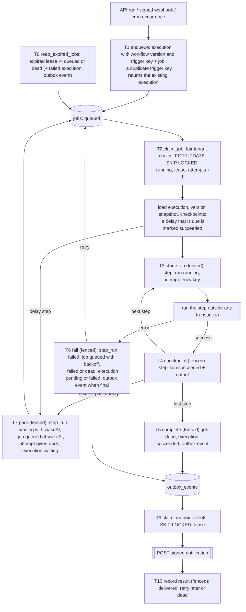

# FlowForge

Multi-tenant durable workflow platform: a tenant defines a workflow as a list of steps (`http`,
`transform`, `log`, `delay`) and starts it through the API, a signed webhook or a cron schedule.
NestJS (API, workers, schedulers from one code base), Next.js 14, PostgreSQL 16 as the only queue and
state store.

[Running](#running) · [Architecture](#architecture) · [Guarantees](#execution-guarantees) ·
[Decisions](#design-decisions) · [Findings](#findings) · [Indexes](#indexes-and-query-plans) ·
[Tests, chaos, load](#tests-chaos-and-load) · [Not done](#not-done-or-done-differently)

## Running

```bash
docker compose -p flowforge up -d --build
```

UI http://localhost:3001, API http://localhost:3000 (ports: `WEB_PORT`, `API_PORT`, `PG_PORT`).
Compose starts Postgres, a one-off `migrate` job, the API, two workers, two schedulers and the
frontend; API, workers and schedulers serve `/metrics`, `/health/live`, `/health/ready` on port 9100
inside the compose network. Configuration: [`apps/api/.env.example`](apps/api/.env.example), validated
at start-up. API reference: [`docs/openapi.json`](docs/openapi.json) (OpenAPI 3.1).

### Example requests

```bash
API=http://localhost:3000

TENANT=$(curl -s -XPOST $API/tenants -H 'x-admin-token: change-me-admin' \
  -H 'content-type: application/json' -d '{"name":"demo"}')
KEY=$(echo "$TENANT" | node -pe 'JSON.parse(require("fs").readFileSync(0)).apiKey')
SECRET=$(echo "$TENANT" | node -pe 'JSON.parse(require("fs").readFileSync(0)).webhookSecret')

WF=$(curl -s -XPOST $API/workflows -H "x-api-key: $KEY" -H 'content-type: application/json' -d '{
  "name": "order",
  "steps": [
    {"id": "order", "type": "http", "method": "POST", "url": "https://httpbin.org/anything/orders",
     "headers": {"content-type": "application/json"},
     "body": "{\"customer\": \"{{ input.customer }}\", \"amount\": {{ input.amount }}}"},
    {"id": "note", "type": "log", "message": "order of {{ input.customer }} received"},
    {"id": "pause", "type": "delay", "ms": 3000},
    {"id": "summary", "type": "transform", "expr": "({ total: ctx.steps.order.body.json.amount * 1.2 })"}
  ]}' | node -pe 'JSON.parse(require("fs").readFileSync(0)).id')

EX=$(curl -s -XPOST $API/workflows/$WF/run -H "x-api-key: $KEY" -H 'x-request-id: demo-1' \
  -H 'content-type: application/json' -d '{"customer": "Ann", "amount": 100}' \
  | node -pe 'JSON.parse(require("fs").readFileSync(0)).id')

curl -N $API/executions/$EX/events -H "x-api-key: $KEY"
curl -s "$API/executions?status=succeeded&limit=20" -H "x-api-key: $KEY"
```

The stream shows `pending → running → waiting → running → succeeded` and ends with
`output: {"total": 120}`, `correlationId: "demo-1"`. Lists return the next page cursor in
`X-Next-Cursor`.

Signed webhook ([Standard Webhooks](https://www.standardwebhooks.com/)). Sending it again returns the
same `executionId`; a changed body or a timestamp older than 5 minutes returns `401`:

```bash
BODY='{"customer": "Bob", "amount": 50}'; ID=evt_1; TS=$(date +%s)
SIG=$(node -e 'const c=require("crypto");const [s,id,ts,b]=process.argv.slice(1);
console.log("v1,"+c.createHmac("sha256",Buffer.from(s.slice(6),"base64")).update(`${id}.${ts}.${b}`).digest("base64"))' \
  "$SECRET" "$ID" "$TS" "$BODY")
curl -s -XPOST $API/hooks/$WF -H 'content-type: application/json' \
  -H "webhook-id: $ID" -H "webhook-timestamp: $TS" -H "webhook-signature: $SIG" -d "$BODY"
```

Notifications about finished executions: `PUT /notifications/endpoint {"url": "https://..."}`. In the
UI, paste the API key on the Connect page, then create, edit, run and follow workflows.

## Architecture

Entry points: `dist/main` (API), `dist/worker` (job runner, lease reaper, outbox dispatcher),
`dist/scheduler` (cron), `dist/migrate`. Processes coordinate only through Postgres.

Each `T` box is one transaction. Every write of a worker is fenced: in the same transaction it checks
that the job is still `running` with its `lockedBy` and `attempts`, so a worker that lost its lease
cannot overwrite the new owner.



## Execution guarantees

| What | Guarantee | Conditions |
|---|---|---|
| Job | Run by at most one worker at a time | Lease + fencing. A worker paused longer than the lease can still finish its in-flight request, hence the idempotency key |
| `http` step | At least once; effectively once if the receiver deduplicates by `Idempotency-Key` | Key `<executionId>:<stepId>`, the same for every attempt; repeated only if the step did not finish (error, crash, shutdown) |
| `transform`, `log` | At least once | No external effect; a `log` line can repeat after a crash before the checkpoint |
| Succeeded step | Never run again | Output stored with the success in one fenced transaction |
| `delay` | Wakes up no earlier than `wakeAt` | Survives restarts, holds no worker slot |
| Execution | One final state, steps of one version | Version fixed at creation; fails with a reason after 3 claims or a non-retryable error |
| Webhook trigger | One execution per `(workflow, webhook-id)` | Unique trigger key; a retry signed with a fresh timestamp is recognised at any later time |
| Cron trigger | One execution per `(workflow, scheduled time)` | Row lock on the schedule + unique trigger key |
| API run | One execution per request | No client idempotency key |
| Notification | At least once, the same `webhook-id` on every attempt | Recorded in the transaction of the final status; 15 attempts with backoff, then `dead`; order not guaranteed |

## Design decisions

### 3.3.1 Queue
- **Chosen:** one `claim_job` function (`FOR UPDATE SKIP LOCKED`) that also sets a lease; heartbeat every
  third of the lease; a reaper in every worker; fencing on every write. Retries with jittered exponential
  backoff (`RETRY_BASE_MS`, `RETRY_CAP_MS`); retryable: network errors, timeouts, 5xx, 408, 425, 429,
  database errors; other errors give `failed`, exhausted attempts `dead`. SIGTERM: stop claiming, wait
  `WORKER_SHUTDOWN_GRACE_MS`, return unfinished jobs without counting the attempt; readiness turns 503.
- **Why:** claiming is a single statement, so a job cannot be taken twice; state is visible in the table
  and survives any process; a lease lets a job run for minutes without an open transaction.
- **Alternatives:** advisory locks (no record of the holder, no "retry at"), `LISTEN/NOTIFY` only (not durable).
- **Limits:** a dead worker is noticed after the lease plus one reaper interval (30 + 5 s); idle slots poll
  every 250 ms.

### 3.3.2 Durable execution
- **Chosen:** one `step_runs` row per `(executionId, stepIndex)`; a retry rebuilds `ctx.steps` from
  succeeded rows and starts at the first unfinished step. Every request of an http step carries
  `Idempotency-Key: <executionId>:<stepId>` and `X-Correlation-Id` (users cannot override them). Changing
  `steps` inserts an immutable `workflow_versions` row; an execution runs the version it was created with.
- **Why:** checkpoint and success are written together, so a succeeded step is never computed again.
- **Alternatives:** copying the steps into every execution instead of versions (duplication, no version
  history).
- **Limits:** effectively-once needs a receiver that honours the key.

### 3.3.3 Durable timers
- **Chosen:** a `delay` step marks its `step_run` `waiting` with `wakeAt` and queues the job with
  `runAt = wakeAt`, giving the attempt back, in one transaction; the worker slot is released.
- **Why:** the timer is a row, so it survives restarts; the job already has `runAt`, no extra process.
- **Alternatives:** a separate timers table with its own poller.
- **Limits:** wake-up is no earlier than `wakeAt`, later by the poll interval or while the tenant is at
  its concurrency limit.

### 3.3.4 Tenant isolation and limits
- **Chosen:** services connect as `flowforge_app` (not a superuser, `NOBYPASSRLS`); the schema belongs to
  `flowforge_owner`, which runs migrations. Every tenant table has row level security
  (`"tenantId" = app_current_tenant()`); `TenantDb.run` opens a transaction and sets
  `app.tenant_id` with `set_config(..., true)`, and services reach the database only through it.
  Cross-tenant operations (key lookup, webhook routing, claims, reaper, rate limit, metrics) are narrow
  `SECURITY DEFINER` functions. API services also filter by `tenantId`.
- **Limits per tenant** (`PATCH /tenants/:id/limits`, defaults in `.env.example`): concurrent jobs
  (checked inside `claim_job` under the tenant's row lock, exact); queued jobs (on enqueue, `429` +
  `Retry-After`); requests per minute (fixed window in Postgres, shared by the API and valid webhooks,
  `X-RateLimit-*`).
- **Why:** a missing check in code still cannot leak data, and a query without a tenant sees no rows
  (`tenancy/row-level-security.int-spec.ts`).
- **Alternatives:** rate limits in memory of each instance (the limit grows with the number of
  instances), a token bucket in Postgres (same round trip, more writes).
- **Limits:** the queue limit is soft (concurrent requests can exceed it by their number); the rate
  window allows up to 2× the limit around its edge.

### 3.3.5 Fair scheduling
- **Chosen:** `claim_job` walks tenants that have ready jobs (skip scan over
  `(tenantId, runAt) WHERE queued`), takes the least recently served one whose state row it can lock
  with `SKIP LOCKED` and whose concurrency limit allows it, and claims its oldest job; contended claims
  retry up to five times with 2 ms pauses.
- **Why:** round-robin between tenants: a backlog costs others at most one job per turn
  ([measurement](#load-fair-scheduling)).
- **Alternatives:** a queue and dispatcher per tenant (more processes), random tenant choice (weaker tail).
- **Limits:** fair per job, not per CPU time; no weights.

### 3.3.6 Safe step execution
- **Chosen, `http`:** a guarded undici agent. `http(s)` only, no credentials; the URL template needs a
  fixed origin, values are percent-encoded and the rendered origin is checked again. Its `lookup`
  resolves every address and refuses the request if any is not public unicast (ipaddr.js; IPv6 only
  `2000::/3`), then connects to the checked address, so a second DNS answer cannot redirect it.
  Redirects are followed manually (≤ `HTTP_MAX_REDIRECTS`), each hop checked again, `Authorization`,
  `Cookie` and `Proxy-Authorization` dropped across origins. One deadline per step (`HTTP_TIMEOUT_MS`);
  the body is streamed and cut at `HTTP_MAX_RESPONSE_BYTES`.
- **Chosen, `transform`:** QuickJS (WebAssembly) in a small thread pool; each evaluation gets a fresh
  runtime with a memory limit (`TRANSFORM_MEMORY_MB`), a 48 KiB stack and an interrupt deadline
  (`TRANSFORM_TIMEOUT_MS`). Input goes in and the result comes out as JSON, so no host object is
  reachable; a thread that misses the deadline is terminated and replaced.
- **All steps:** outputs over `STEP_OUTPUT_MAX_BYTES` or 64 levels fail without retry; log messages are
  escaped and cut at 2 KiB; the definition is limited (50 steps, body 64 KiB, expression 4 KiB,
  delay ≤ 1 h, connection headers forbidden).
- **Alternatives:** `request-filtering-agent`/`ssrf-req-filter` (made for `http.Agent`, no redirect
  control); egress proxy (needs another service); `vm`/`new Function` (not a boundary); `isolated-vm`
  (native module); an expression language (breaks existing expressions).
- **Limits:** the SSRF guard lives in the worker process; `SSRF_ALLOWLIST` (empty by default) bypasses
  it for listed hosts.

### 3.3.7 Incoming webhooks
- **Chosen:** `webhook-signature: v1,<base64 HMAC-SHA256(key, id.timestamp.raw body)>` over the bytes
  as received, compared with `timingSafeEqual` against every active secret; timestamp within
  `WEBHOOK_TOLERANCE_SECONDS`; trigger key `webhook:<workflowId>:<webhook-id>` with a unique index, so a
  redelivery returns the existing execution. Rotation: `POST /webhook-secrets` returns a new secret once,
  the old ones stay valid for `WEBHOOK_SECRET_GRACE_SECONDS`; `DELETE` revokes at once.
- **Why:** the starter `x-signature` over a re-serialised body could not stop replays; Standard Webhooks
  is what senders already implement.
- **Alternatives:** a seen-ids table cleaned after twice the window (lets late retries through).
- **Limits:** secrets are stored in plain text, protected by row level security.

### 3.3.8 Scheduler
- **Chosen:** a separate process (two replicas). `workflows.nextRunAt` is stored and indexed; a tick
  claims one due workflow at a time (`FOR UPDATE SKIP LOCKED`), enqueues its occurrences with trigger
  keys `cron:<workflowId>:<time>` and moves `nextRunAt` in the same transaction; ticks are chained with
  `setTimeout`. Cron is evaluated with `cron-parser@4` in the workflow's IANA time zone, from the
  previous planned run. Missed runs (older than `SCHEDULER_MISFIRE_GRACE_MS`): `skip`, `once` (default,
  the latest one) or `all` (up to `SCHEDULER_MAX_CATCH_UP_RUNS`). Crons firing more often than once a
  minute are rejected.
- **Why:** the row lock and the unique key each prevent a second run on their own.
- **Alternatives:** leader election with an advisory lock (one instance does all the work, failover waits
  for the session to end).
- **Limits:** the start moment depends on the clock of the scheduler host.

### 3.3.9–3.3.11 Notifications, observability, frontend
- **Outbox:** `record_execution_event` inserts an `outbox_events` row in the transaction of every final
  status when the tenant has an endpoint; the dispatcher claims events with `SKIP LOCKED`, posts
  `{type, timestamp, data}` through the SSRF guard, signs it like a webhook with separate outbound
  secrets and retries with backoff.
- **Correlation:** `x-request-id` (or a new UUID) is returned on every response and stored as
  `executions.correlationId`; workers log it with `tenantId`, `executionId`, `jobId`, `attempt`,
  `stepId` and send it as `X-Correlation-Id` in http steps and notifications. Logs are pino JSON with
  secrets redacted; unexpected errors answer `500 Internal server error`.
- **Metrics:** `flowforge_queue_depth{tenant_id,status}`, `flowforge_job_claim_latency_seconds`,
  `flowforge_step_duration_seconds`, `flowforge_job_retries_total`, `flowforge_jobs_dead_total`, plus
  outbox, scheduler, rate limit and HTTP metrics.
- **Frontend:** SSE (one direction, built-in reconnect, plain HTTP through the Next.js proxy) fed by
  `pg_notify` triggers on `executions` and `step_runs`; each (re)connection gets a full snapshot. The
  page closes the stream on unmount and on a final status and reconnects with backoff. Executions list
  with cursor pagination and status/workflow filters; workflow form with validation; loading, empty and
  error states.

## Findings

Every finding has a reproduction that fails on the commit that adds it and passes on the next commit
(the fix); `scripts/prove-finding.sh F-NN` checks both. Lines refer to `initial commit` (`5acc271`),
paths are under `apps/api` unless they start with `apps/`. F-21 (non-atomic transitions) is part of F-18.

### F-01 · Any tenant can read any execution by id · Tenant isolation · Critical
- **What:** `src/executions/executions.controller.ts:31-34`, `src/executions/executions.service.ts:33-37` look up by id only.
- **Why dangerous:** any API key reads another tenant's input, output and step results.
- **Reproduce:** `test/integration/findings/F-01-execution-detail-isolation.int-spec.ts`.
- **Fix** (`c77c536`): lookup by `(id, tenantId)`, row level security on top.
- **Alternatives:** checking the owner in each controller (easy to forget).

### F-02 · Tenant isolation unit test cannot fail · Tests that pass regardless · Medium
- **What:** `test/executions.service.spec.ts:8,23-26` mocks the repository to return `[]` and expects `[]`.
- **Why dangerous:** green for any implementation, including one that returns every tenant's data.
- **Reproduce:** `scripts/mutation/F-02.sh` removes the tenant filter; the old test stays green.
- **Fix** (`0bc710c`): `test/integration/findings/F-02-execution-list-isolation.int-spec.ts` with two tenants on a real database; red under the same mutation.
- **Alternatives:** asserting mock arguments (still tied to the implementation).

### F-03 · Concurrent workers execute the same job several times · Queue, several workers · Critical
- **What:** `src/engine/job-queue.service.ts:17-34`: `SELECT`, then `UPDATE` by id without a lock or status check.
- **Why dangerous:** slots polling at the same moment take the same job, so payments or emails in http steps repeat.
- **Reproduce:** `test/integration/findings/F-03-exactly-once-claim.int-spec.ts` (4 workers × 4 slots, 200 jobs).
- **Fix** (`7f29ccb`): one `UPDATE ... FOR UPDATE SKIP LOCKED` in `claim_job`.
- **Alternatives:** advisory locks; optimistic `WHERE status = 'queued'` with retries.

### F-04 · Jobs of a crashed worker are never recovered · Worker crash · Critical
- **What:** `src/engine/job-queue.service.ts:6,17-21` never looks at `lockedUntil`; `src/engine/job-runner.service.ts:36-50` never renews the lease.
- **Why dangerous:** a killed worker leaves its jobs `running` forever.
- **Reproduce:** `test/integration/findings/F-04-lease-recovery.int-spec.ts`.
- **Fix** (`99f8e63`): heartbeat, reaper (`queued`, or `dead` with a failed execution), fencing.
- **Alternatives:** a transaction or advisory lock held per job (cannot span a delay).

### F-05 · A stopping worker abandons its current job · Worker crash · High
- **What:** `src/engine/job-runner.service.ts:32-34` only sets `running = false`.
- **Why dangerous:** every deploy strands in-flight jobs.
- **Reproduce:** `test/integration/findings/F-05-graceful-shutdown.int-spec.ts` (SIGTERM to a real worker process mid-step).
- **Fix** (`25432ff`): stop claiming, wait up to 25 s (compose `stop_grace_period` is 30 s), release the rest.
- **Alternatives:** only waiting or only releasing.

### F-06 · A job whose workflow was deleted hangs forever · Poison jobs · High
- **What:** `src/engine/job-runner.service.ts:53-54` loads with `findOneOrFail` outside the `try`; `src/workflows/workflows.service.ts:55-58` deletes workflows that have queued runs.
- **Why dangerous:** the job stays `running` and the execution `pending` forever.
- **Reproduce:** `test/integration/findings/F-06-poison-job.int-spec.ts`.
- **Fix** (`3d91407`): a missing execution, workflow or version fails the job with a reason.
- **Alternatives:** forbidding deletion while runs are queued.

### F-07 · Transform steps run arbitrary code on the host · Step security · Critical
- **What:** `src/engine/step-executor.ts:30-37` uses `new Function`.
- **Why dangerous:** `process.env` (database credentials, admin token), `child_process`; `while(true){}` blocks the worker.
- **Reproduce:** `test/integration/findings/F-07-transform-sandbox.int-spec.ts`.
- **Fix** (`55505f6`): QuickJS sandbox ([3.3.6](#336-safe-step-execution)).
- **Alternatives:** `vm`, `isolated-vm`, an expression language.

### F-08 · Http steps can reach internal addresses · Step security · Critical
- **What:** `src/engine/step-executor.ts:39-46` fetches any URL and follows redirects.
- **Why dangerous:** cloud metadata, Postgres and the API in the compose network, loopback services.
- **Reproduce:** `test/integration/findings/F-08-ssrf.int-spec.ts` (loopback notations, private ranges, metadata, IPv6, redirects, rebinding).
- **Fix** (`59434fe`): guarded undici agent ([3.3.6](#336-safe-step-execution)).
- **Alternatives:** filtering agents for `http.Agent`, an egress proxy.

### F-09 · Step results are read and stored without a size limit · Resource limits · High
- **What:** `src/engine/step-executor.ts:47` (`res.text()`), `:18` (log), `src/engine/job-runner.service.ts:68` (output).
- **Why dangerous:** one huge response exhausts the worker's memory; huge outputs bloat the database.
- **Reproduce:** `test/integration/findings/F-09-response-size-limits.int-spec.ts`.
- **Fix** (`0c154e4`): `content-length` check, streaming cap, output cap, log cap; non-retryable.
- **Alternatives:** silent truncation.

### F-10 · Input values can rewrite the url of an http step · Step security · High
- **What:** `src/engine/template.ts:16-21` inserts values as they are; `src/engine/step-executor.ts:40` renders the URL.
- **Why dangerous:** `https://api.example.com{{ input.p }}` with `p="@169.254.169.254/"` changes the host.
- **Reproduce:** `test/integration/findings/F-10-url-template-injection.int-spec.ts`.
- **Fix** (`ee31917`): percent-encoding, fixed origin required and re-checked, lookups on own properties only.
- **Alternatives:** no placeholders in URLs; checking only the host.

### F-11 · Webhook signatures are checked against a re-serialized body · Webhook authenticity · High
- **What:** `src/webhooks/webhooks.controller.ts:31` signs `JSON.stringify(parsed body)`.
- **Why dangerous:** signatures over the real bytes fail; different bodies share a signature; non-JSON is verified as `{}`.
- **Reproduce:** `test/integration/findings/F-11-raw-body-signature.int-spec.ts`.
- **Fix** (`b791793`): HMAC over the raw bytes; `415` for non-JSON.
- **Alternatives:** canonical JSON.

### F-12 · Webhook signatures are compared with a timing leak · Webhook authenticity · Medium
- **What:** `src/webhooks/webhooks.controller.ts:32` uses `!==`.
- **Why dangerous:** response time reveals how much of a guessed signature is right.
- **Reproduce:** `test/integration/findings/F-12-constant-time-signature.int-spec.ts`.
- **Fix** (`3cf2c69`): base64 decode, fixed 32-byte length, `timingSafeEqual`.
- **Alternatives:** comparing HMACs of both values.

### F-13 · Replayed and stale webhooks start new executions · Webhook redelivery · High
- **What:** `src/webhooks/webhooks.controller.ts:20-38`: no timestamp, window or deduplication.
- **Why dangerous:** a captured request can be replayed at any time; a sender's retry runs the workflow twice.
- **Reproduce:** `test/integration/findings/F-13-webhook-replay.int-spec.ts` (replay, retry with a fresh timestamp, 10 concurrent duplicates).
- **Fix** (`f9ee8af`): id and timestamp in the signature, tolerance window, unique trigger key.
- **Alternatives:** a seen-ids table with expiry.

### F-14 · Every scheduler instance fires the same occurrence · Scheduler, several instances · High
- **What:** `src/scheduler/scheduler.service.ts:19-22,29-46` runs in every API instance (`src/app.module.ts:29`) without coordination.
- **Why dangerous:** N replicas run each cron workflow N times.
- **Reproduce:** `test/integration/findings/F-14-scheduler-multi-instance.int-spec.ts`.
- **Fix** (`cc545b7`): scheduler process, row-locked claim, unique trigger keys.
- **Alternatives:** leader election; the unique key alone.

### F-15 · Schedules ignore their time zone · Scheduler, time zones · High
- **What:** `src/scheduler/scheduler.service.ts:38` calls `parseExpression` without `tz`.
- **Why dangerous:** runs in the time zone of the process (UTC in Docker) and ignores DST of the tenant.
- **Reproduce:** `test/integration/findings/F-15-schedule-time-zones.int-spec.ts` (winter, summer, spring gap, autumn repeat).
- **Fix** (`206afc7`): the workflow's `tz`; time zones validated.
- **Alternatives:** another cron library.

### F-16 · Runs missed while the scheduler is down are lost · Scheduler, restart · High
- **What:** `src/scheduler/scheduler.service.ts:12` keeps `lastTick` in memory; `:43-47` moves it on after an enqueue error.
- **Why dangerous:** downtime or a failed enqueue silently drops runs.
- **Reproduce:** `test/integration/findings/F-16-missed-runs-after-restart.int-spec.ts`.
- **Fix** (`91a7b34`): persistent `nextRunAt`, moved only with the enqueue; missed-run policies.
- **Alternatives:** persisting `lastTick` per instance.

### F-17 · A slow scheduler tick overlaps the next and fires twice · Scheduler, restart · Medium
- **What:** `src/scheduler/scheduler.service.ts:21` uses `setInterval` with an async tick.
- **Why dangerous:** a tick slower than the interval overlaps the next one with the same `lastTick`.
- **Reproduce:** `test/integration/findings/F-17-overlapping-ticks.int-spec.ts`.
- **Fix** (`ab5eea8`): ticks chained with `setTimeout`.
- **Alternatives:** a "running" flag.

### F-18 · A retry repeats steps that already succeeded · Execution properties · Critical
- **What:** `src/engine/job-runner.service.ts:60-64` starts from step 0 on every attempt; `:56-91` updates three tables in separate statements.
- **Why dangerous:** a failure in a later step repeats earlier side effects; a crash between statements leaves, for example, a `succeeded` execution with a `running` job.
- **Reproduce:** `test/integration/findings/F-18-resume-from-checkpoint.int-spec.ts`.
- **Fix** (`b02e231`): fenced per-step checkpoints, one transaction per transition, idempotency keys.
- **Alternatives:** event sourcing; requiring idempotent steps from users.

### F-19 · A running execution picks up edits of its workflow · Execution properties · High
- **What:** `src/engine/job-runner.service.ts:54` loads the current workflow; `src/workflows/workflows.service.ts:45-48` keeps no history.
- **Why dangerous:** one execution mixes steps of two versions.
- **Reproduce:** `test/integration/findings/F-19-workflow-version-snapshot.int-spec.ts`.
- **Fix** (`4847db6`): immutable `workflow_versions`.
- **Alternatives:** copying steps into executions.

### F-20 · A delay holds a worker slot and restarts after a crash · Execution properties · High
- **What:** `src/engine/step-executor.ts:20-22` uses `setTimeout`.
- **Why dangerous:** a 1 h delay blocks a slot for an hour; a restart starts the execution over.
- **Reproduce:** `test/integration/findings/F-20-durable-delay.int-spec.ts`.
- **Fix** (`a762382`): durable timers ([3.3.3](#333-durable-timers)).
- **Alternatives:** a separate timers table.

### F-22 · The execution page polls forever and leaks its timer · Client that degrades · Medium
- **What:** `apps/frontend/app/executions/[id]/page.tsx:11-16`: `setInterval` without cleanup.
- **Why dangerous:** every visit adds a timer that never stops, requests overlap, errors show "Loading…" forever.
- **Reproduce:** `apps/frontend/test/findings/F-22-execution-page-updates.test.tsx`.
- **Fix** (`09fc220`): SSE with cleanup, stop on a final status, error and reconnect states.
- **Alternatives:** fixing the polling.

### F-23 · Input is not validated at the API boundary · Validation · Medium
- **What:** `src/workflows/workflows.service.ts:7-13,29` takes an interface; `src/executions/executions.controller.ts:27-28` uses `Number(limit)`.
- **Why dangerous:** a missing `name` or `limit=abc` answers `500`; invalid cron or time zone is stored; `* * * * * *` runs every second.
- **Reproduce:** `test/integration/findings/F-23-input-validation.int-spec.ts`.
- **Fix** (`b503556`): DTO classes, query DTO, cron and time zone checks, definition limits.
- **Alternatives:** one JSON schema for the definition.

### F-24 · Webhook responses reveal which workflows exist · Webhook authenticity · Low
- **What:** `src/webhooks/webhooks.controller.ts:27-28`: `404` for unknown or disabled workflows, `401` for a bad signature.
- **Why dangerous:** workflow ids can be probed without a secret.
- **Reproduce:** `test/integration/findings/F-24-webhook-enumeration.int-spec.ts`.
- **Fix** (`a8280f7`): the same `401` for all three cases.
- **Alternatives:** equalising response time as well.

### F-25 · API runs as a database superuser and accepts a placeholder admin token · Security, configuration · High
- **What:** `docker-compose.yml:4-7` and `.env.example:2` connect as the superuser, `src/app.module.ts:22` has `synchronize: true`, `.env.example:3` is a placeholder `ADMIN_TOKEN`.
- **Why dangerous:** any injection owns the database, row level security is impossible, the schema changes on start, anyone can create tenants.
- **Reproduce:** `test/integration/findings/F-25-least-privilege.int-spec.ts`.
- **Fix** (`02fd4b4`): owner and app roles, migrations, a config check that refuses a placeholder token in production.
- **Alternatives:** one non-superuser role for everything.

### F-26 · A NUL character makes data impossible to store · Validation, storage · Medium
- **What:** Postgres cannot store `\u0000`; request bodies (`src/main.ts:6`) and step results (`src/engine/job-runner.service.ts:68,70`) are not checked.
- **Why dangerous:** `500` with a database error; a response with NUL fails every attempt.
- **Reproduce:** `test/integration/findings/F-26-nul-characters.int-spec.ts`.
- **Fix** (`2c7af7b`): `400` for such bodies, U+FFFD in stored results.
- **Alternatives:** storing outputs as `bytea`.

### F-27 · Deeply nested JSON crashes the API and poisons steps · Resource limits · Medium
- **What:** `src/main.ts:6` and `src/engine/job-runner.service.ts:68` accept any nesting.
- **Why dangerous:** stack overflow answers `500`; such a step response fails every attempt.
- **Reproduce:** `test/integration/findings/F-27-deeply-nested-json.int-spec.ts`.
- **Fix** (`e23b2a1`): iterative depth check (64) of bodies (`400`) and outputs (non-retryable).
- **Alternatives:** catching `RangeError`.

### F-28 · One tenant's backlog delays every other tenant · Fairness · High
- **What:** `src/engine/job-queue.service.ts:19` claims in global `runAt` order.
- **Why dangerous:** other tenants wait for the whole backlog (p95 31 s in the load test).
- **Reproduce:** `test/integration/findings/F-28-noisy-neighbour.int-spec.ts`, `npm run load:fairness`.
- **Fix** (`e33c796`): round-robin claim ([3.3.5](#335-fair-scheduling)).
- **Alternatives:** per-tenant queues; random tenant choice.

### F-29 · Input values can inject fields into an http step body · Step security · High
- **What:** `src/engine/step-executor.ts:44` renders the body without encoding.
- **Why dangerous:** `{"name": "{{ input.name }}"}` with `x", "role": "admin` adds a field; `x&role=admin` does it in a form.
- **Reproduce:** `test/integration/findings/F-29-body-template-injection.int-spec.ts`.
- **Fix** (`e2a9f3f`): values encoded for the body format (JSON string, JSON value, form).
- **Alternatives:** a structured body object; no placeholders in bodies.

## Indexes and query plans

| Query | Index | Time, ms |
|---|---|---|
| Tenants with ready jobs / oldest ready job of a tenant / queue limit | `IDX_jobs_queued_by_tenant (tenantId, runAt) WHERE status='queued'` | 0.355 / 0.011 / 0.464 |
| Running jobs of a tenant | `IDX_jobs_running_by_tenant` or `IDX_jobs_expired_leases` (both partial on `running`) | 0.038 |
| Expired leases | `IDX_jobs_expired_leases (lockedUntil) WHERE status='running'` | 1.249 |
| Executions of a tenant, newest first, with cursor | `IDX_executions_tenant_created (tenantId, createdAt, id)` | 0.114 |
| … by status / by workflow | `IDX_executions_tenant_status_created`, `IDX_executions_tenant_workflow_created` | 0.241 / 0.230 |
| Trigger key (idempotency of webhooks and cron) | `UQ_executions_tenant_trigger_key (tenantId, triggerKey) WHERE NOT NULL` | 0.029 |
| Checkpoints / version snapshot | `UQ_step_runs_execution_step`, `UQ_workflow_versions_workflow_version` | 0.065 / 0.018 |
| Next due schedule | `IDX_workflows_next_run_at WHERE nextRunAt IS NOT NULL` | 0.024 |
| Due and abandoned notifications | `IDX_outbox_events_due`, `IDX_outbox_events_expired_leases` | 0.277 |

**How verified:** `test/integration/db/query-plans.int-spec.ts` loads 50 tenants, 5 000 workflows,
100 000 executions and jobs, 160 000 step runs and 50 000 outbox events, then calls the real `TenantDb`
and `ExecutionsService` as the application role; `auto_explain` reports the plan of every statement,
including those inside the PL/pgSQL queue functions. It requires the expected index, no sequential scan
of a large table and no sort of more than one page; removing an index from the migrations fails it.
Times are actual times from one run (`QUERY_PLAN_REPORT=plans.md npx jest query-plans` writes them).
The test found that the list by workflow sorted all executions of the workflow (estimate 2 rows, actual
100, because `tenantId` and `workflowId` are correlated); the migration
`1794321100000-execution-workflow-statistics` adds dependency statistics on the pair and fixes the plan.

## Tests, chaos and load

```bash
cd apps/api && npm ci && npm run lint && npm run typecheck
npm run test:unit                # 330 tests, no database
npm run test:int                 # 284 tests, Postgres 16 via Testcontainers (Docker)
cd ../frontend && npm ci && npm run lint && npm test && npm run build   # 66 tests
cd ../.. && scripts/prove-finding.sh F-03    # red before the fix, green after it
```

Each integration test file gets its own database cloned from a migrated template; CI runs all of the
above except `prove-finding.sh`.

| Requirement (task 6) | Tests |
|---|---|
| Backoff, definition validation, sandbox, webhook signature, cron in time zones and on DST dates | `test/retry-backoff.spec.ts`, `definition.spec.ts`, `workflow-definition-limits.spec.ts`, `sandbox.spec.ts`, `webhook-signature.spec.ts`, `cron-schedule.spec.ts` |
| N workers × M jobs, each exactly once | F-03 |
| Worker killed mid-step: picked up, finished steps not repeated, side effect once | `test/integration/chaos/worker-killed-mid-step.int-spec.ts`, F-04, F-18 |
| Two scheduler instances, one run | F-14, `scheduler/scheduling.int-spec.ts` |
| Tenant A cannot see or change B, also bypassing services | `tenancy/row-level-security.int-spec.ts`, `tenancy/api-isolation.int-spec.ts`, F-01, F-02 |
| SSRF, sandbox escape, webhook replay, changed body | `safe-http.spec.ts`, F-07, F-08, F-11, F-13 |
| OpenAPI document matches the API | `api/openapi.int-spec.ts` |

### Chaos: all workers killed in the middle of a payment

```bash
docker compose -p flowforge -f docker-compose.yml -f docker-compose.chaos.yml up -d --build
cd apps/api && npm run chaos:kill-workers
```

The overlay adds `sink` (`docker/chaos/sink.js`), which applies each effect once per `Idempotency-Key`,
holds the first `/charge` for 6 s and records notifications, and lets workers reach it through
`SSRF_ALLOWLIST`. The script runs 10 executions of `reserve → charge → delay 2 s → email` with a
notification endpoint, sends SIGKILL to both workers while charges are in flight, restarts them and
exits with an error if any guarantee is broken. Result, the same on every run (Apple M1, Docker 8 CPUs):

| Finished after the kill | Succeeded | reserve: attempts / requests / effects | charge | email | Notifications |
|---|---|---|---|---|---|
| 35.2–35.8 s | 10 / 10 | 10×1 / 10 / 10 | 2×1 + 8×2 / 18 / 10 | 10×1 / 10 / 10 | 10, all distinct ids |

Killed jobs come back after the 30 s lease and the next reaper pass; interrupted charges ran again with
the same key and were applied once; the reserve step was not repeated. With an idempotency key that
changes per attempt, or with checkpoints ignored, the script fails.

### Load: fair scheduling

```bash
cd apps/api && npm run load:fairness
```

Tenant A enqueues 20 000 executions while workers are stopped; then workers start and tenants B and C
start one execution per second for 60 s. Latency is from creation to the start of the first step.
Baseline: the same scenario on the code before the fix (`e1c84fc`). 2 workers × 4 slots, Apple M1,
Docker 8 CPUs.

| Claim order | B and C while A's backlog drains: p50 / p95 / p99, ms | After it drained: p95, ms |
|---|---|---|
| FIFO (baseline) | 16 161 / 31 139 / 32 115 | 238–243 |
| Round-robin | 13–15 / 29 / 765–791 | 248–255 |

The backlog drained at 470 jobs/s on the current code and 622 jobs/s on the baseline, which also lacks
everything added after it (live update triggers, outbox, logging context, metrics, limits), so the
difference is not the cost of the fair claim alone.

## Changes to existing tests

| File | Change | Reason |
|---|---|---|
| `apps/api/test/executions.service.spec.ts` | removed | could not fail (F-02), replaced by a real test |
| `apps/api/test/job-queue.spec.ts` | removed two `it.todo` | implemented by F-03 and F-04 |

The other starter tests are unchanged and green.

## Not done, or done differently

- An egress proxy in front of the workers as a second SSRF barrier.
- Secrets encrypted with a KMS key.
- `Idempotency-Key` for `POST /workflows/:id/run`; manual retry of failed executions; input for Run in
  the UI.
- Weighted fairness or fairness by CPU time; `LISTEN/NOTIFY` wake-up instead of 250 ms polling.
- The runtime image still contains `typescript` and `ts-node` (peer dependencies of TypeORM).
- No dedicated test for fencing of notification delivery results.
