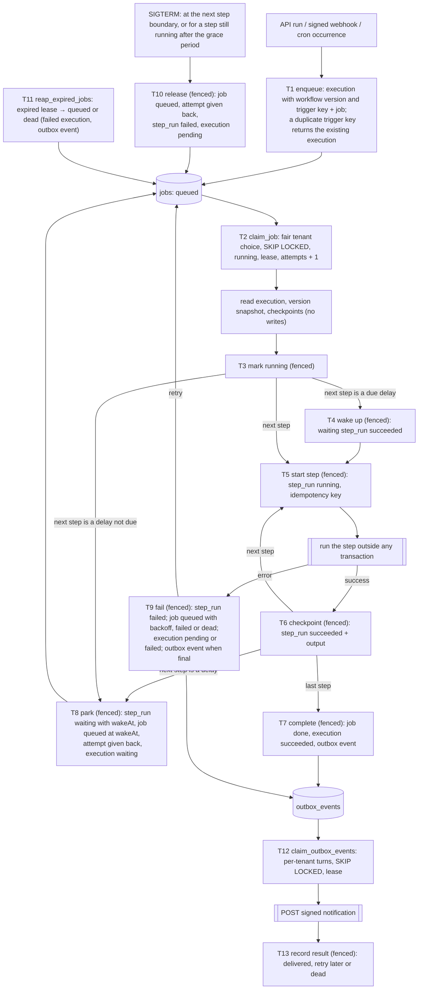

# FlowForge

Multi-tenant durable workflow platform. A workflow is a list of `http`, `transform`, `log` and `delay`
steps, started by the API, a signed webhook or cron. NestJS (API, worker, scheduler from one code base),
Next.js 15, PostgreSQL 16 as the only queue and state store.

[Running](#running) · [Architecture](#architecture) · [Guarantees](#execution-guarantees) ·
[Decisions](#design-decisions) · [Findings](#findings) · [Indexes](#indexes-and-query-plans) ·
[Tests, chaos, load](#tests-chaos-and-load) · [Changed tests](#changes-to-existing-tests) ·
[Not done](#not-done-or-done-differently)

## Running

```bash
cp .env.example .env                    # set ADMIN_TOKEN, CLIENT_ADDRESS_SECRET and the three passwords
cp apps/api/.env.example apps/api/.env
docker compose -p flowforge up -d --build --wait
scripts/smoke.sh                        # tenant → workflow → run → succeeded, frontend answers
```

Needs Docker Compose 2.20+; `scripts/smoke.sh` needs `curl` and `jq`, the mutation scripts `python3`.
UI http://localhost:3001, API http://localhost:3000, reference [`docs/openapi.json`](docs/openapi.json)
(OpenAPI 3.1). Compose runs Postgres, a one-off `migrate`, the API, 2 workers, 2 schedulers, the frontend
and an nginx edge, published on `127.0.0.1` only. The `frontend` network holds edge, frontend and API, the
`backend` network the API, workers, schedulers and Postgres; containers drop all Linux capabilities.
`/metrics` and `/health/{live,ready}` listen on 9100 inside the network (outside compose each process needs
its own `METRICS_PORT`).

| File | Holds |
|---|---|
| `.env` | secrets (`openssl rand -hex 32` for `ADMIN_TOKEN`, `CLIENT_ADDRESS_SECRET`; `-hex 24` for `POSTGRES_PASSWORD`, `FLOWFORGE_OWNER_PASSWORD`, `FLOWFORGE_APP_PASSWORD`), ports, optional `APP_ORIGIN`, `TRUSTED_PROXY_HOPS` |
| `apps/api/.env` | every platform setting with its default, validated at start-up |
| `apps/frontend/.env` | `API_URL` for `npm run dev`; in production also `CLIENT_ADDRESS_SECRET`, `APP_ORIGIN`, `TRUSTED_PROXY_HOPS` |

- Only `migrate` gets the owner role; services connect as `flowforge_app` and refuse to start as the owner,
  a superuser or a `BYPASSRLS` role.
- `CLIENT_ADDRESS_SECRET` is the same for API and frontend and required in production on both; only with it
  does the API trust the browser address the frontend forwards. `TRUST_PROXY` (API) lists proxies whose
  `X-Forwarded-For` the API may read; empty in compose.
- Behind TLS set `APP_ORIGIN=https://...` (`Origin` checked against it, `Secure` cookie, HSTS); with proxies
  in front of the edge set `TRUSTED_PROXY_HOPS`. UI login: paste a tenant's `apiKey` at `/connect`.

### Example requests

```bash
API=http://localhost:3000
ADMIN_TOKEN=$(grep ^ADMIN_TOKEN= .env | cut -d= -f2)
TENANT=$(curl -s -XPOST $API/tenants -H "x-admin-token: $ADMIN_TOKEN" -H 'content-type: application/json' -d '{"name":"demo"}')
KEY=$(echo "$TENANT" | jq -r .apiKey); SECRET=$(echo "$TENANT" | jq -r .webhookSecret)

WF=$(curl -s -XPOST $API/workflows -H "x-api-key: $KEY" -H 'content-type: application/json' -d '{
  "name": "order",
  "steps": [
    {"id": "order", "type": "http", "method": "POST", "url": "https://httpbin.org/anything/orders",
     "headers": {"content-type": "application/json"},
     "body": "{\"customer\": \"{{ input.customer }}\", \"amount\": {{ input.amount }}}"},
    {"id": "pause", "type": "delay", "ms": 3000},
    {"id": "summary", "type": "transform", "expr": "({ total: ctx.steps.order.body.json.amount * 1.2 })"}
  ]}' | jq -r .id)

EX=$(curl -s -XPOST $API/workflows/$WF/run -H "x-api-key: $KEY" -H 'x-request-id: demo-1' \
  -H 'content-type: application/json' -d '{"customer": "Ann", "amount": 100}' | jq -r .id)
curl -N $API/executions/$EX/events -H "x-api-key: $KEY"        # pending → running → waiting → succeeded
curl -s "$API/executions?status=succeeded&limit=20" -H "x-api-key: $KEY"   # next page: X-Next-Cursor

BODY='{"customer": "Bob", "amount": 50}'; ID=evt_1; TS=$(date +%s)
SIG=$(node -e 'const c=require("crypto");const [s,id,ts,b]=process.argv.slice(1);
console.log("v1,"+c.createHmac("sha256",Buffer.from(s.slice(6),"base64")).update(`${id}.${ts}.${b}`).digest("base64"))' \
  "$SECRET" "$ID" "$TS" "$BODY")
curl -s -XPOST $API/hooks/$WF -H 'content-type: application/json' \
  -H "webhook-id: $ID" -H "webhook-timestamp: $TS" -H "webhook-signature: $SIG" -d "$BODY"   # again: same executionId

curl -s -XPOST $API/workflows -H "x-api-key: $KEY" -H 'content-type: application/json' -d '{
  "name": "nightly", "cron": "30 2 * * *", "timezone": "Europe/Kyiv", "missedRunPolicy": "once",
  "steps": [{"id": "note", "type": "log", "message": "run for {{ input.scheduledAt }}"}]}'

curl -s -XPOST $API/tenants/$(echo "$TENANT" | jq -r .id)/api-key -H "x-admin-token: $ADMIN_TOKEN"   # new key, old one revoked
```

Notifications: `PUT /notifications/endpoint {"url": "https://..."}` returns the signing secret once;
delivery state at `GET /notifications/events?status=dead`.

## Architecture

Processes `dist/main` (API), `dist/worker` (jobs, lease reaper, outbox, retention), `dist/scheduler`,
`dist/migrate` coordinate only through Postgres. Each `T` box is one transaction. Every worker write is
fenced: in the same transaction it checks that the job is still `running` with its `lockedBy` (worker id and
a token new for every claim) and `attempts`.



## Execution guarantees

| What | Guarantee | Conditions |
|---|---|---|
| Job | Only the current claim records results; a worker that lost its claim may still finish a request already sent | Lease + fencing token per claim; a worker gives a job up when its last renewal is older than the lease minus 1 s |
| `http` step | At least once; effectively once if the receiver deduplicates by `Idempotency-Key` | Key `<executionId>:<stepId>`, same body on every attempt; repeated only if the step did not finish |
| `transform`, `log` | At least once | No external effect |
| Succeeded step | Never run again | Output stored with the success in one fenced transaction |
| `delay` | Wakes no earlier than `wakeAt` | Survives restarts, holds no worker slot |
| Execution | One final state, steps of one version | Version fixed at creation; fails after `JOB_MAX_ATTEMPTS` (8) attempts of one step, a non-retryable error or outputs over `EXECUTION_OUTPUT_MAX_BYTES` |
| Webhook / cron trigger | One execution per `(tenant, webhook-id)` / `(workflow, scheduled time)`; a `webhook-id` sent to another workflow gets `409` | Unique trigger key (+ row lock on the schedule) |
| API run | One execution per request | No client idempotency key |
| Notification | At least once, same `webhook-id` on every attempt | Written with the final status; 15 attempts with backoff, then `dead`; order not guaranteed |

## Design decisions

### 3.3.1 Queue
- **Chosen:** `claim_job` (`FOR UPDATE SKIP LOCKED`) sets a lease; heartbeats every third of the lease plus a
  local deadline; a reaper in every worker (locks tenant rows in a fixed order, so two reapers cannot
  deadlock); fencing on every write with `lockedBy = <workerId>:<uuid>`, new per claim, so an old write of
  the same worker cannot pass even after a delay gave the attempt back. Attempts count per step
  (`JOB_MAX_ATTEMPTS` 8), jittered exponential backoff (`RETRY_BASE_MS`, `RETRY_CAP_MS`); retryable: network
  errors, timeouts, 5xx, 408, 425, 429; exhausted jobs are `dead`. SIGTERM: stop claiming, start no further
  step, release jobs at the step boundary or after `WORKER_SHUTDOWN_GRACE_MS`, without counting the attempt.
- **Why:** one statement claims, so a job cannot be taken twice; a lease runs a job for minutes without an
  open transaction; per-step attempts keep the progress of long workflows.
- **Alternatives:** advisory locks (no holder record, no "retry at"); `LISTEN/NOTIFY` only (not durable).
- **Limits:** a dead worker is noticed after lease + reaper pass (30 + 5 s); idle slots poll every 250 ms;
  the pool needs `2 × WORKER_CONCURRENCY + OUTBOX_CONCURRENCY + 2` connections.

### 3.3.2 Durable execution
- **Chosen:** one `step_runs` row per step; a retry rebuilds `ctx.steps` from succeeded rows and starts at the
  first unfinished step, so a retried request has the same bytes. `Idempotency-Key` and `X-Correlation-Id`
  on every http request. Changing `steps` inserts an immutable `workflow_versions` row; an execution runs the
  version it was created with.
- **Why:** checkpoint and success are one transaction, so a succeeded step is never computed again.
- **Alternatives:** copying steps into every execution (duplication, no history); event sourcing.
- **Limits:** effectively-once needs a receiver that honours the key.

### 3.3.3 Durable timers
- **Chosen:** `delay` marks its step `waiting` with `wakeAt` and requeues the job with `runAt = wakeAt`,
  giving the attempt back, in one transaction.
- **Why:** the timer is a row: survives restarts, needs no extra process, holds no slot.
- **Alternatives:** a timers table with its own poller.
- **Limits:** wake-up is late by up to the poll interval, or while the tenant is at its concurrency limit.

### 3.3.4 Tenant isolation and limits
- **Chosen:** services connect as `flowforge_app` (`NOBYPASSRLS`); the schema belongs to `flowforge_owner`.
  Every tenant table has row level security on `app.tenant_id`, set per transaction by `TenantDb.run`, and
  every API and worker query also filters by `tenantId`; foreign keys `(tenantId, executionId)` and the
  unique `(tenantId, workflowId, version)` keep rows of one tenant from touching another's. Cross-tenant
  work (key lookup, webhook routing, claims, reaper, retention, metrics, key rotation) goes through narrow
  `SECURITY DEFINER` functions. RLS is not `FORCE`d: only the owner bypasses it, and the owner runs only
  migrations and those functions; tables without policies are not granted to `flowforge_app`.
- **API keys:** 192-bit, stored as SHA-256; `POST /tenants/:id/api-key` (admin) issues a new key and revokes
  the old one at once (open event streams last until they reconnect).
- **Limits per tenant** (`PATCH /tenants/:id/limits`): running jobs (exact, in `claim_job`), ready queued jobs
  (`429` + `Retry-After`), requests per minute (window in Postgres, `X-RateLimit-*`), workflows
  (`TENANT_MAX_WORKFLOWS`). Failed authentication is limited per client address in memory before any
  database work, separately for API keys, the admin token and each workflow's webhooks. The browser address
  is the one the nginx edge appends to `X-Forwarded-For` (Next.js keeps a header the client sent).
- **Why:** a missing check in code still cannot leak data; a query without tenant context sees nothing
  (`tenancy/row-level-security.int-spec.ts`).
- **Alternatives:** schema per tenant (migrations × tenants); in-memory rate limits (grow with instances).
- **Limits:** the queue limit is soft under concurrent requests and ignores jobs waiting for a timer or a
  retry; the concurrency limit counts running jobs, so executions asleep in a `delay` do not use it; the rate
  window allows up to 2× at its edge; failed logins are counted per API instance.

### 3.3.5 Fair scheduling
- **Chosen:** `tenant_queue_state` holds per tenant the last claim and `idleUntil`. `claim_job` takes non-idle
  tenants, least recently served first, locks one whose concurrency limit allows it and claims its oldest
  ready job; a tenant with nothing ready is marked idle until its earliest job, and a trigger on `jobs` wakes
  it (the enqueue holds `FOR KEY SHARE`, the idle mark `FOR UPDATE` plus a second look, so no job is missed).
- **Why:** a backlog costs other tenants at most one job per turn ([measured](#load-fair-scheduling)); 5 000
  idle tenants cost p50 0.3 ms per claim instead of 12.7–12.9 ms with the previous `claim_job`
  (`npm run load:idle-claims`, three runs).
- **Alternatives:** a queue and dispatcher per tenant; random tenant choice (weaker tail).
- **Limits:** fair per job, not per CPU time; no weights; a tenant at its concurrency limit with a backlog is
  looked at on every claim (not measured with many such tenants).

### 3.3.6 Safe step execution
- **`http`:** guarded undici agent. The URL template needs a fixed origin; values are percent-encoded; the
  rendered origin is re-checked. `lookup` resolves every address (2 s), refuses any that is not public
  unicast (and Azure's `168.63.129.16`) and connects to the checked address, so DNS rebinding cannot redirect
  it. Redirects are followed by hand, each hop checked (a malformed `Location` is permanent), credentials
  dropped across origins. One deadline per step, body cut at `HTTP_MAX_RESPONSE_BYTES`; JSON bodies get JSON
  escaping, forms form encoding.
- **`transform`:** JavaScript in QuickJS (WebAssembly) in a small thread pool; a fresh runtime per evaluation
  with `TRANSFORM_MEMORY_MB`, a 48 KiB stack and `TRANSFORM_TIMEOUT_MS`; JSON in and out, so no host object
  is reachable; result size checked inside the sandbox; error texts cut to 640 characters, stored step errors
  to 2 KiB.
- **All steps:** outputs over `STEP_OUTPUT_MAX_BYTES`, 64 levels or `EXECUTION_OUTPUT_MAX_BYTES` fail without
  retry; definitions are limited (50 steps, body 64 KiB, expression 4 KiB, delay ≤ 1 h); request bodies are
  limited to 1 MiB in the API, the edge and the frontend proxy.
- **Why QuickJS:** `vm`/`new Function` are not a boundary; `isolated-vm` is a native module per Node version;
  WebAssembly has no Node APIs and exact limits.
- **Alternatives:** `request-filtering-agent` (no redirect control), an egress proxy, an expression language.
- **Limits:** `SSRF_ALLOWLIST` bypasses the guard per host; `'x'.repeat(n)` ignores the deadline, so the thread
  is killed `max(250 ms, timeout)` after it; bodies other than JSON and forms get values as they are.

### 3.3.7 Incoming webhooks
- **Chosen:** Standard Webhooks: `v1,<base64 HMAC-SHA256(id.timestamp.raw body)>` over the received bytes
  (compressed bodies `415`), `timingSafeEqual` against every active secret, timestamp within
  `WEBHOOK_TOLERANCE_SECONDS`, trigger key `webhook:<webhook-id>` unique per tenant: a redelivery is a no-op
  and the same delivery sent to another workflow gets `409`. `POST /webhook-secrets` rotates; old secrets stay
  valid for `WEBHOOK_SECRET_GRACE_SECONDS`, at most three are active.
- **Why:** senders already implement the scheme; the unique key makes any later redelivery a no-op.
- **Alternatives:** a seen-ids table cleaned after the window (lets late retries through); canonical JSON;
  a secret per workflow.
- **Limits:** secrets are stored in plain text behind RLS; a secret belongs to the tenant, so its holder can
  sign for every workflow of the tenant, and a sender must use a new `webhook-id` per workflow.

### 3.3.8 Scheduler
- **Chosen:** a separate process (two replicas); a tick claims one due workflow by indexed `nextRunAt`
  (`FOR NO KEY UPDATE SKIP LOCKED`, which a concurrent manual run does not block), enqueues with trigger key
  `cron:<workflowId>:<time>` and moves `nextRunAt` in the same transaction. Missed runs follow the workflow's
  `missedRunPolicy`: `skip`, `once` (default) or `all` (up to `SCHEDULER_MAX_CATCH_UP_RUNS`), counted after
  commit. A full tenant queue postpones by `SCHEDULER_POSTPONE_MS`.
- **Time zones:** `cron-parser` lists wall-clock times, `src/scheduler/zoned-cron.ts` maps them with `Intl`
  offsets: a missing time moves forward and a repeated one runs once; only hourly crons (`*`, `0-23`) follow
  elapsed time. Tested over two years in 17 cases in 11 zones (30-minute, 2-hour and midnight changes).
- **Why:** the row lock and the unique key each prevent a second run on their own.
- **Alternatives:** leader election with an advisory lock (one busy instance, failover waits for the session).
- **Limits:** the start moment depends on the scheduler host clock; crons more often than once a minute are
  refused; `enabled: false` stops cron and webhooks, a manual run still works.

### 3.3.9–3.3.11 Notifications, observability, frontend
- **Outbox:** a row in the transaction of every final status; the dispatcher claims with `SKIP LOCKED` in
  per-tenant turns, at most `OUTBOX_TENANT_CONCURRENCY` in flight (also when re-sending a crashed
  dispatcher's events), posts through the SSRF guard, signs like a webhook, retries with backoff.
- **Observability:** `x-request-id` becomes `executions.correlationId` (cron runs get a new one), is logged with
  tenant, execution, job, attempt and step and sent as `X-Correlation-Id`; pino JSON logs, secrets redacted;
  metrics `flowforge_queue_depth{tenant_id,status}`, `flowforge_job_claim_latency_seconds`,
  `flowforge_step_duration_seconds`, `flowforge_job_retries_total`, `flowforge_jobs_dead_total` and more.
  Queue depth and outbox backlog are queried by the API only, with 2 s; if the database does not answer they
  keep their last value and `flowforge_metrics_collect_errors_total` grows. A database that does not answer
  makes requests fail with `503` + `Retry-After`.
- **Real time:** SSE (one-way, reconnects by itself, passes the Next.js proxy), fed by `pg_notify` for watched
  executions; outputs over 8 KiB are left out of snapshots; a slow client gets only the latest snapshot.
- **Frontend:** the page closes its stream on unmount and on a final status, reconnects with backoff;
  executions list with cursor pages and a status filter; workflow form with the API rules and `If-Match` on
  `revision` (`412` on a stale form); loading, empty and error states; CSP with a nonce; the proxy streams
  answers, follows no redirects and stops when the browser leaves.
- **Retention:** workers delete data finished more than `RETENTION_DAYS` (30) ago and unused versions.

## Findings

Each finding has a reproduction that fails on the commit adding it and passes on the next (the fix):
`scripts/prove-finding.sh F-NN`. The reproduction is `apps/api/test/integration/findings/F-NN-*.int-spec.ts`
unless noted. Lines refer to `initial commit` (`5acc271`), paths under `apps/api` unless they start with
`apps/`; F-21 (non-atomic transitions) is part of F-18.

| Finding · category · severity | What | Why dangerous | Fix (commit) | Alternatives |
|---|---|---|---|---|
| **F-01** Any tenant can read any execution · Isolation · Critical | `src/executions/executions.controller.ts:31-34`, `executions.service.ts:33-37` look up by id only | any API key reads another tenant's input, output and steps | `c77c536`: lookup by `(id, tenantId)`, RLS on top | an owner check per controller |
| **F-02** Isolation unit test cannot fail · Tests · Medium | `test/executions.service.spec.ts:8,23-26` mocks `[]` and expects `[]` | green for any implementation | `0bc710c`: `F-02-execution-list-isolation`, two tenants on a real database; proof by `scripts/mutation/F-02.sh` | asserting mock arguments |
| **F-03** Workers run the same job several times · Queue · Critical | `src/engine/job-queue.service.ts:17-34`: `SELECT`, then `UPDATE` without a lock | payments or emails repeat | `7f29ccb`: one `UPDATE ... FOR UPDATE SKIP LOCKED` | advisory locks; optimistic retries |
| **F-04** Jobs of a crashed worker never recover · Worker crash · Critical | `job-queue.service.ts:6,17-21` ignores `lockedUntil`; `job-runner.service.ts:36-50` never renews | jobs stay `running` forever | `99f8e63`: heartbeat, reaper, fencing | a transaction or lock held per job |
| **F-05** A stopping worker abandons its job · Worker crash · High | `job-runner.service.ts:32-34` only sets `running = false` | every deploy strands jobs | `25432ff`: stop claiming, wait, release | only waiting or only releasing |
| **F-06** A job of a deleted workflow hangs · Poison jobs · High | `job-runner.service.ts:53-54` `findOneOrFail` outside `try` | job `running`, execution `pending` forever | `3d91407`: fail the job with a reason | forbid deleting with queued runs |
| **F-07** Transform runs arbitrary code · Step security · Critical | `src/engine/step-executor.ts:30-37` `new Function` | `process.env`, `child_process`; `while(true){}` blocks the worker | `55505f6`: QuickJS sandbox | `vm`, `isolated-vm` |
| **F-08** Http steps reach internal addresses · Step security · Critical | `step-executor.ts:39-46` fetches any URL, follows redirects | cloud metadata, Postgres, loopback | `59434fe`: guarded agent (also `test/safe-http.spec.ts`) | filtering agents, egress proxy |
| **F-09** Results read and stored without limit · Resources · High | `step-executor.ts:47` `res.text()`, `:18`; `job-runner.service.ts:68` | one response exhausts worker memory | `0c154e4`: length check, streaming cap, output cap | silent truncation |
| **F-10** Input rewrites the url of an http step · Step security · High | `src/engine/template.ts:16-21` inserts values as they are | `{{ input.p }}` = `@169.254.169.254/` changes the host | `ee31917`: percent-encoding, fixed origin | no placeholders in URLs |
| **F-11** Signature over a re-serialized body · Webhooks · High | `src/webhooks/webhooks.controller.ts:31` signs `JSON.stringify(body)` | real signatures fail; bodies share a signature | `b791793`: HMAC over raw bytes, `415` | canonical JSON |
| **F-12** Signature compared with a timing leak · Webhooks · Medium | `webhooks.controller.ts:32` uses `!==` | timing reveals a guessed prefix | `3cf2c69`: decode, 32 bytes, `timingSafeEqual` | comparing HMACs of both |
| **F-13** Replayed and stale webhooks run again · Redelivery · High | `webhooks.controller.ts:20-38`: no timestamp, window, dedup | a captured request replays any time | `f9ee8af`: id and timestamp signed, window, unique key | seen-ids table |
| **F-14** Every scheduler instance fires · Scheduler · High | `src/scheduler/scheduler.service.ts:19-22,29-46` in every API (`src/app.module.ts:29`) | N replicas run each cron N times | `cc545b7`: scheduler process, row lock, unique key | leader election |
| **F-15** Schedules ignore their time zone · Scheduler · High | `scheduler.service.ts:38` `parseExpression` without `tz` | runs in UTC, ignores DST | `206afc7`: the workflow's zone, validated | another cron library |
| **F-16** Runs missed during downtime are lost · Scheduler · High | `scheduler.service.ts:12` `lastTick` in memory; `:43-47` | downtime silently drops runs | `91a7b34`: persistent `nextRunAt`, policies | `lastTick` per instance |
| **F-17** Overlapping ticks fire twice · Scheduler · Medium | `scheduler.service.ts:21` `setInterval` with an async tick | a slow tick overlaps the next | `ab5eea8`: chained `setTimeout` | a running flag |
| **F-18** A retry repeats succeeded steps · Durable · Critical | `job-runner.service.ts:60-64` from step 0; `:56-91` three tables apart | earlier side effects repeat; a crash leaves mixed states | `b02e231`: fenced checkpoints, one transaction per transition | event sourcing |
| **F-19** A running execution picks up edits · Durable · High | `job-runner.service.ts:54` loads the current workflow | one execution mixes two versions | `4847db6`: `workflow_versions` | copying steps |
| **F-20** A delay holds a slot, restarts after a crash · Durable · High | `step-executor.ts:20-22` `setTimeout` | a 1 h delay blocks a slot | `a762382`: durable timers | a timers table |
| **F-22** Execution page polls forever · Client · Medium | `apps/frontend/app/executions/[id]/page.tsx:11-16` `setInterval` without cleanup; test `apps/frontend/test/findings/F-22-*` | timers pile up, "Loading…" forever | `09fc220`: SSE with cleanup and states | fixing the polling |
| **F-23** Input not validated at the boundary · Validation · Medium | `src/workflows/workflows.service.ts:7-13,29` interface; `executions.controller.ts:27-28` `Number(limit)` | `500`s; invalid cron stored | `b503556`: DTO classes, cron and zone checks | one JSON schema |
| **F-24** Webhook answers reveal workflows · Webhooks · Low | `webhooks.controller.ts:27-28` `404` vs `401` | ids can be probed | `a8280f7`: the same `401` | equal timing too |
| **F-25** Superuser connection, placeholder admin token · Configuration · High | `docker-compose.yml:4-7`, `.env.example:2-3`, `src/app.module.ts:22` `synchronize` | an injection owns the database | `02fd4b4`: owner and app roles, migrations, token check | one non-superuser role |
| **F-26** A NUL character cannot be stored · Validation · Medium | `src/main.ts:6`, `job-runner.service.ts:68,70` | `500`; a step fails every attempt | `2c7af7b`: `400`, U+FFFD in results | `bytea` outputs |
| **F-27** Deep JSON crashes the API · Resources · Medium | `src/main.ts:6`, `job-runner.service.ts:68` | stack overflow, poisoned steps | `e23b2a1`: iterative depth check (64) | catching `RangeError` |
| **F-28** One tenant's backlog delays all · Fairness · High | `job-queue.service.ts:19` global `runAt` order | p95 31 s for others in the load test | `e33c796`: round-robin claim | per-tenant queues |
| **F-29** Input injects fields into a body · Step security · High | `step-executor.ts:44` renders the body raw | `x", "role": "admin` adds a field | `e2a9f3f`: encoding per body format | structured body object |

### Starter defects without a red commit

Fixed while building a feature or found by a later review. Where a mutant is named,
`scripts/mutation/starter-defects.sh [mutant]` puts the defect back and requires the test to fail (8/8 killed);
the other tests were checked to fail before the fix.

| Defect · category · severity | Why dangerous | Fix | Test · mutant |
|---|---|---|---|
| No database timeouts (`src/app.module.ts:18-23`) · Resources · High | a paused Postgres hangs every request | `987ffa7`: connect, statement, client timeouts | `db/timeouts` · `database-timeouts` |
| Admin token checked after validation (`src/tenants/tenants.controller.ts:27-31`) · Security · Low | `400` answers reveal the admin API | `987ffa7`: guard first | `tenancy/admin-endpoint` · `admin-token-after-validation` |
| Frontend proxy without deadline, any path segment, `/api/connect` without origin check · Security · Medium | hanging requests; `..` reaches other routes; login CSRF | `24bcf46` | frontend route tests · `proxy-without-timeout`, `proxy-without-path-check`, `connect-without-origin-check` |
| Non-atomic transitions (F-21) | a `done` job with a `running` execution | `b02e231` | `outbox/notifications` · `non-atomic-completion` |
| `timestamp` without time zone (`src/entities/execution.entity.ts:32`) · Correctness · Medium | times shifted by the database offset (12 h in the test) | `8ec4901`: `timestamptz` | `db/database-time-zone` · `timestamps-without-time-zone` |
| F-12 test only checked that `timingSafeEqual` was called · Tests · Medium | a plain comparison next to it survived | asserts the compared values and the decision | `F-12-*` · `signature-decided-by-plain-comparison` |
| Tenant secret not bound to a workflow (`webhooks.controller.ts:31`) · Webhooks · High | a delivery replayed to another workflow starts it | trigger key per tenant, `409` | `webhooks/cross-workflow-replay` |
| Ports on all interfaces (`docker-compose.yml:8,20,36`), root image with dev dependencies (`Dockerfile`) · Infrastructure · Medium | Postgres and API reachable from the network | `127.0.0.1`, networks, `npm ci --omit=dev`, user `node` | `scripts/smoke.sh` in CI |
| `log` step via plain-text logger (`src/engine/step-executor.ts:18`) · Observability · Low | a newline forges log lines | escaped, cut, JSON logs | `log-message.spec`, `logger.spec` |

Defects in the new code found by later reviews are fixed in the `fix: resolve defects found in the ... code
review` and `fix: harden ...` commits, each with a test checked to fail without it; fencing of every worker
write is proven by `scripts/mutation/fencing.sh` (2/2 killed).

## Indexes and query plans

| Query | Index |
|---|---|
| Tenants that may have ready jobs | `IDX_tenant_queue_state_idle (idleUntil)` |
| Oldest ready job of a tenant, queue limit | `IDX_jobs_queued_by_tenant (tenantId, runAt) WHERE status='queued'` |
| Running jobs of a tenant, expired leases | `IDX_jobs_running_by_tenant`, `IDX_jobs_expired_leases (lockedUntil)` (partial on `running`) |
| Executions: newest, by status, by workflow | `IDX_executions_tenant_created`, `_tenant_status_created`, `_tenant_workflow_created` |
| Workflows of a tenant | `IDX_workflows_tenant_created (tenantId, createdAt, id)` |
| Idempotency of webhooks and cron | `UQ_executions_tenant_trigger_key (tenantId, triggerKey) WHERE NOT NULL` |
| Checkpoints, version snapshot | `UQ_step_runs_execution_step`, `UQ_workflow_versions_tenant_workflow_version` |
| Next due schedule | `IDX_workflows_due (COALESCE(scheduleRetryAt, nextRunAt))` (partial) |
| Notifications: due, abandoned, of a tenant | `IDX_outbox_events_pending_by_tenant`, `_expired_leases`, `_tenant_created`, `_tenant_status_created` |
| Retention | `IDX_executions_finished`, `IDX_executions_unfinished_version`, `IDX_outbox_events_finished`, `IDX_outbox_events_execution`, `IDX_jobs_execution`, `IDX_execution_watches_expires` |
| Same-tenant references | `UQ_executions_tenant_id (tenantId, id)` |

`test/integration/db/query-plans.int-spec.ts` loads 50 tenants, 5 000 workflows, 100 000 executions and
jobs, 160 000 step runs, 50 000 notifications and 10 000 sleeping jobs, calls the real services as the
application role and reads every plan through `auto_explain` (also inside PL/pgSQL). It requires the
expected index, no sequential scan of a large table and, for claims, fewer than 1 000 rows discarded by a
filter (dropping one of these indexes by hand makes it fail). `QUERY_PLAN_REPORT=plans.md npx jest
query-plans` writes the times.

## Tests, chaos and load

```bash
cd apps/api && npm ci && npm run lint && npm run typecheck
npm run test:unit                # no database
npm run test:int                 # Postgres 16 via Testcontainers (Docker)
npm run load:idle-claims         # claim cost with 5 000 idle tenants (Docker)
cd ../frontend && npm ci && npm run lint && npm run typecheck && npm test && npm run build
cd ../.. && scripts/prove-finding.sh F-03          # red before the fix, green after it
scripts/mutation/starter-defects.sh && scripts/mutation/fencing.sh
```

Each integration test file gets its own database cloned from a migrated template (`TEST_DATABASE_URL` uses
an existing server). CI runs lint, typecheck, all tests, a production dependency audit, builds the images,
starts the stack and runs `scripts/smoke.sh`.

| Requirement (task 6) | Tests |
|---|---|
| Backoff, definitions, sandbox, webhook signature, cron with DST | `retry-backoff.spec.ts`, `definition.spec.ts`, `sandbox.spec.ts`, `webhook-signature.spec.ts`, `cron-schedule.spec.ts` |
| N workers × M jobs, each exactly once | F-03 |
| Worker killed mid-step: finished steps not repeated, effect once | `chaos/worker-killed-mid-step.int-spec.ts`, F-04, F-18 |
| Two scheduler instances, one run | F-14, `scheduler/scheduling.int-spec.ts` |
| Tenant A cannot see or change B, also bypassing services | `tenancy/*.int-spec.ts`, F-01, F-02 |
| SSRF, sandbox escape, webhook replay, changed body | `safe-http.spec.ts`, F-08, F-07, F-13, F-11, `webhooks/cross-workflow-replay` |
| OpenAPI matches the API | `api/openapi.int-spec.ts` |

### Chaos: all workers killed in the middle of a payment

```bash
docker compose -p flowforge -f docker-compose.yml -f docker-compose.chaos.yml up -d --build
cd apps/api && npm run chaos:kill-workers
docker compose -p flowforge up -d --remove-orphans   # afterwards: drops the sink and SSRF_ALLOWLIST
```

The `sink` (`docker/chaos/sink.js`) applies each effect once per `Idempotency-Key` and holds the first
`/charge` for 6 s. 10 executions of `reserve → charge → delay 2 s → email`; both workers get SIGKILL while
charges are in flight and are restarted. Three runs, Apple M1, Docker 8 CPUs:

| Finished after the kill | Succeeded | reserve: attempts / requests / effects | charge | email | Notifications |
|---|---|---|---|---|---|
| 36.8–36.9 s | 10 / 10 | 10×1 / 10 / 10 | 2×1 + 8×2 / 18 / 10 | 10×1 / 10 / 10 | 10, distinct ids |

Killed jobs return after the 30 s lease and a reaper pass; interrupted charges ran again with the same key
and were applied once. With a key per attempt, or without checkpoints, the script fails.

### Load: fair scheduling

`cd apps/api && npm run load:fairness`: tenant A enqueues 20 000 executions while workers are stopped, then
B and C start one per second for 60 s; latency is creation to first step. 2 workers × 4 slots, three runs.
Baseline: the same script on `e1c84fc` (before the fix).

| Claim order | B and C during A's backlog: p50 / p95 / p99, ms | After it: p95, ms | Drain |
|---|---|---|---|
| FIFO (baseline) | 16 161 / 31 139 / 32 115 | 238–243 | 622 jobs/s |
| Round-robin | 13–15 / 18–50 / 516–573 | 207–263 | 476–511 jobs/s |

After the backlog the slots are idle and poll every 250 ms, hence the higher latency; the baseline also
lacks everything added later, so the throughput gap is not the fair claim alone.

## Changes to existing tests

| File | Change | Reason |
|---|---|---|
| `executions.service.spec.ts` (starter) | removed | could not fail (F-02), replaced by a real test |
| `job-queue.spec.ts` (starter) | two `it.todo` removed; tests `retryCeilingMs` instead of `backoffMs` | done by F-03, F-04; `backoffMs` was dead code, so the test proved nothing |
| `definition.spec.ts` (starter) | one case added | unknown step fields are refused |
| `findings/F-09-*`, `F-12-*`, `F-25-*` | 256 KiB output instead of 8 MB; asserts the compared values; production start sets `CLIENT_ADDRESS_SECRET` | 8 MB hit the timeout; calling `timingSafeEqual` was not enough; the secret is required |
| `findings/F-20-*`, `execution/checkpoints`, `queue/lease*`, `chaos/worker-killed-mid-step` | wait for a state, not a time | fixed sleeps were flaky |
| `apps/frontend/test/findings/F-22-*` | assertions on connections, requests and timers | the old ones passed whatever the page did |
| `tenancy/tenant-limits`, `api/failed-authentication-limit` | no `429` among concurrent requests; webhooks have their own bucket | the queue limit is soft; buckets were split |
| `retry-backoff.spec.ts`, `storable.spec.ts`, `body-template.spec.ts` | `backoffMs` comparison removed; reviver renamed; JSON-looking text bodies escaped | code changed accordingly |
| `api/openapi`, `webhooks/request-boundary`, `db/query-plans` | 1 MiB oversized body; new index name; seed fills queue state | request limit and schema changed |
| `db/database-time-zone` | workers stopped before migrating back and forth | `ALTER TABLE` next to running workers logged deadlocks |
| `config.spec.ts`, frontend `hardening`, `instrumentation`, route and page tests | `CLIENT_ADDRESS_SECRET` in production configs; `Host` only for the origin; Next.js 15 params; `error` field; `revision` tag | requirements and framework upgrades |
| `test/support/*`, `vitest.config.mts` | built like `main.ts`; `projects` instead of `environmentMatchGlobs` | Vitest 4 |

The other starter tests are unchanged and green.

## Not done, or done differently

- An egress proxy as a second SSRF barrier; secrets encrypted with a KMS key; a webhook secret per workflow.
- `Idempotency-Key` for `POST /workflows/:id/run`; manual retry of failed executions; deleting tenants.
- Weighted fairness; `LISTEN/NOTIFY` wake-up instead of 250 ms polling.
- The UI keeps the API key in an http-only 12-hour cookie, not a server-side session.
- Admin `SECURITY DEFINER` functions are not limited to a separate role; `claim_due_schedule` trusts its time.
- The edge and frontend can reach the API's port 9100 (shared network); compose cannot filter ports.
- Older migrations build indexes without `CONCURRENTLY`; new ones are concurrent and can be re-run after a
  partial failure. The `timestamptz` migration rewrites tables unless the database time zone is UTC.
- Not measured: watched notifications vs commit throughput; outbox in-flight limits can be exceeded by one
  per dispatcher claiming at the same moment.
- The runtime image contains `typescript` and `ts-node` (TypeORM peers); `typeorm` 0.3 pulls `glob`/`minimatch`
  with moderate advisories (CI fails on high and critical).
